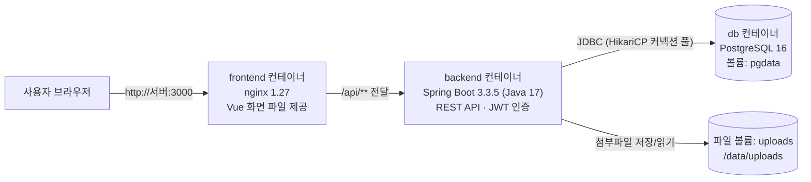
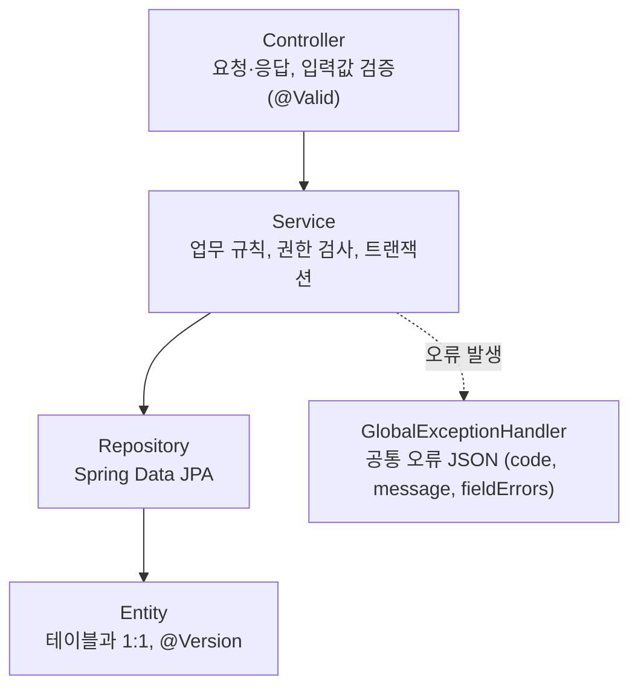
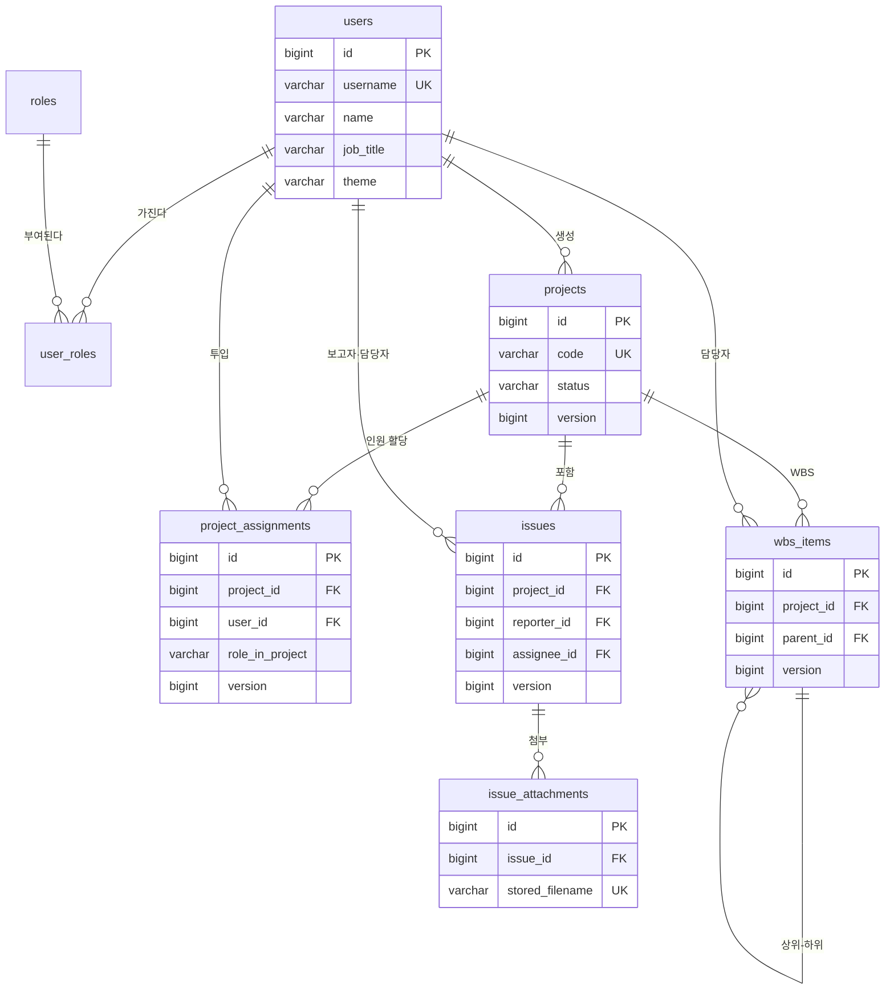
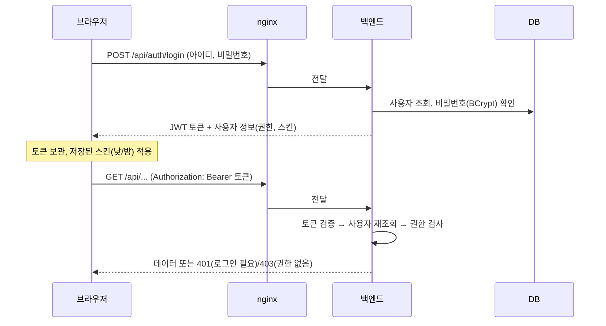
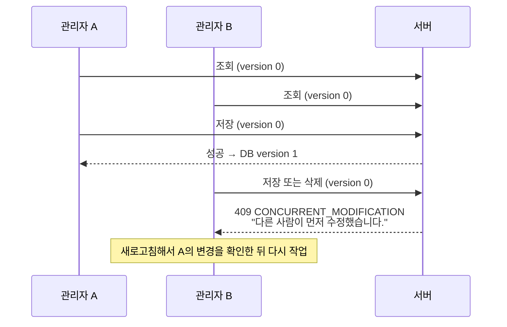
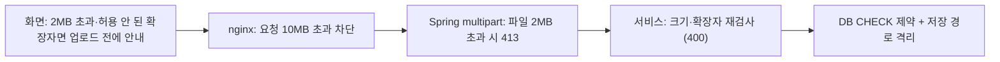

# 전사 Project 관리 시스템 — 아키텍처 문서

| 항목 | 내용 |
|---|---|
| 문서 종류 | 아키텍처 문서 (시스템 구조·기술·데이터·보안·배포) |
| 대상 독자 | 개발자, 운영 담당자, 시스템을 인수받는 사람 |
| 기준 버전 | `main` 브랜치, DB 마이그레이션 V9 |
| 작성일 | 2026-10-26 |
| 관련 문서 | [사용 매뉴얼](user-manual.md), [상세 설계서](specs.md), [WBS 설계 부록](specs-wbs.md), [README](../README.md) |

---

## 1. 시스템 개요

전사 Project 관리 시스템은 SI 프로젝트의 **인력 투입 현황**, **이슈**, **WBS(작업 분해 구조) 일정**을 한곳에서 관리하는 웹 시스템이다.

| 기능 영역 | 주요 내용 |
|---|---|
| 대시보드 | 전체 프로젝트·투입 인원·이슈 현황, 프로젝트별 인원 차트, 프로젝트 기간 타임라인 |
| 이슈 관리 | Jira와 비슷한 이슈 등록·수정·삭제, 상태/우선순위/담당자, 첨부파일(파일당 최대 2MB) |
| WBS | 프로젝트별 작업 계층(최대 5단계) 작성, 계획/실제 일정, 진척률 자동 집계, 간트 차트 |
| Admin 콘솔 | 프로젝트, 인원 할당, 사용자, 월별 타임시트(MM), 계획 vs 실제 투입 공기 |
| 공통 | JWT 로그인, 역할별 권한(ADMIN / 프로젝트 PM / 일반 사용자), 사용자별 낮·밤 스킨, 동시 수정 덮어쓰기 방지 |

---

## 2. 시스템 구성도

사용자는 브라우저로 **nginx**(웹 서버, 포트 3000)에 접속한다. nginx는 화면 파일을 직접 내려주고, `/api`로 시작하는 요청만 **Spring Boot 백엔드**(포트 8080)로 넘긴다. 백엔드는 **PostgreSQL**(포트 5432)에 데이터를 저장하고, 첨부파일은 별도 디스크 볼륨에 저장한다. 세 구성 요소는 모두 Docker 컨테이너로 실행된다.



| 컨테이너 | 이미지 | 포트 | 저장소(볼륨) | 역할 |
|---|---|---|---|---|
| `frontend` | nginx 1.27 (Node 20으로 빌드) | 3000 → 80 | 없음 | 화면 파일 제공, `/api` 프록시, 화면 진입점 캐시 제어 |
| `backend` | eclipse-temurin 17 JRE (Maven 3.9로 빌드) | 8080 | `uploads` | REST API, 인증·권한, 업무 규칙, 첨부파일 저장 |
| `db` | postgres:16-alpine | 5432 | `pgdata` | 업무 데이터 저장 |

---

## 3. 기술 스택

정확한 버전의 기준은 `frontend/package.json`, `backend/pom.xml`, 각 `Dockerfile`이다.

### 3.1 백엔드

| 구분 | 기술 | 버전 | 쓰는 곳 |
|---|---|---|---|
| 언어·프레임워크 | Java, Spring Boot | 17, 3.3.5 | 전체 REST API |
| 보안 | Spring Security + jjwt | jjwt 0.12.6 | JWT 로그인, URL·메서드 단위 권한 검사 |
| 데이터 접근 | Spring Data JPA (Hibernate) | Boot 기준 | 조회·저장, `@Version` 낙관적 잠금 |
| 커넥션 풀 | HikariCP | Boot 기준 | DB 연결 재사용 (6장 참고) |
| DB 변경 관리 | Flyway | Boot 기준 | 테이블 생성·변경 이력 (V1~V9) |
| 테스트 | JUnit 5, MockMvc, H2 | Boot 기준 | 통합 테스트 (H2를 PostgreSQL 모드로 실행) |

### 3.2 프론트엔드

| 구분 | 기술 | 버전 | 쓰는 곳 |
|---|---|---|---|
| 프레임워크·빌드 | Vue 3, Vite | 3.4, 5.4 | 전체 화면 |
| 상태·라우팅 | Pinia, Vue Router | 2.2, 4.4 | 로그인 정보, 화면 이동과 권한 가드 |
| UI 컴포넌트 | Element Plus | 2.8 | 버튼, 입력 폼, 팝업, 탭, 메뉴, 다크 모드 |
| 데이터 그리드 | AG Grid Community | 32.3 | 모든 목록 표 (테마 `ag-theme-quartz`) |
| 차트 | Apache ECharts + vue-echarts | 5.5, 6.7 | 대시보드 차트, 계획 vs 실제 차트 |
| 간트 차트 | ECharts custom series (직접 구현) | - | `frontend/src/utils/gantt.js` — 대시보드 타임라인, 타임시트 Gantt, WBS Gantt 공용 |
| 기타 | axios, dayjs | 1.7, 1.11 | API 호출, 날짜 계산 |
| 테스트 | Vitest, Vue Test Utils | 2.1, 2.4 | 화면 단위 테스트 |

---

## 4. 소스 구조

### 4.1 저장소 최상위

```text
.
├── backend/              Spring Boot 서버
├── frontend/             Vue 3 화면 (nginx.conf, Dockerfile 포함)
├── docs/                 설계서·아키텍처 문서·사용 매뉴얼
├── docker-compose.yml    3개 컨테이너 실행 정의 + 커넥션 풀 설정
├── README.md             개요, 기술 스택, 실행 방법
└── CLAUDE.md             AI 작업 지침 (한국어 응답 등)
```

### 4.2 백엔드 패키지 (`backend/src/main/java/com/sipm`)

| 패키지 | 역할 |
|---|---|
| `auth` | 로그인(`/api/auth/login`), 내 정보, 내 스킨 저장 |
| `security` | JWT 발급·검증 필터, 로그인 사용자 정보(`AppUserPrincipal`) |
| `config` | Spring Security 설정(URL 권한 규칙), CORS 설정 |
| `user` | 사용자·역할 엔티티, 사용자 관리 API, 직급 규칙 |
| `project` | 프로젝트 엔티티와 관리 API, 프로젝트 목록·멤버 조회 |
| `assignment` | 인원 할당(투입/철수일, 역할, 투입률), 기간 겹침 검사 |
| `issue` | 이슈 등록·조회·수정·삭제, 검색 조건 |
| `attachment` | 첨부파일 업로드·다운로드·삭제, 2MB·확장자 검사, 저장 경로 격리 |
| `wbs` | WBS 항목, 진척률 집계(`WbsRollupCalculator`), 이동·재번호, PM 권한 검사 |
| `dashboard` | 대시보드 요약·프로젝트 지표 |
| `admin` | 월별 타임시트, 계획 vs 실제 집계 |
| `metrics` | MM(인월) 계산 공통 로직(`ManMonthCalculator`) |
| `common` | 공통 오류 응답(`ErrorCode`, `GlobalExceptionHandler`), 낙관적 잠금 검사(`OptimisticLocks`), 페이징·정렬 |

백엔드는 **Controller → Service → Repository → Entity** 순서의 단순한 계층 구조다. 업무 규칙과 권한 검사는 Service에 모여 있다.



### 4.3 프론트엔드 구조 (`frontend/src`)

| 폴더 | 역할 |
|---|---|
| `api/` | 서버 API 호출 함수, 공통 axios 설정(`http.js`: 토큰 첨부, 오류 메시지 처리) |
| `stores/` | Pinia 상태 저장소 (로그인 `auth`, 이슈 `issue`, WBS `wbs`, 공통 목록 `lookup`) |
| `router/` | 화면 주소 정의, 로그인 가드, 재배포 후 화면 파일 로딩 실패 시 자동 새로고침 |
| `layouts/` | 공통 레이아웃(헤더·사이드바), Admin 탭 레이아웃 |
| `views/` | 화면 단위 컴포넌트 (대시보드, 이슈, WBS, Admin 5개 화면, 로그인) |
| `components/` | 표·팝업·차트 등 화면 부품 |
| `utils/` | 상수(상태 이름, 직급·역할 목록), 간트 차트 빌더, 스킨 적용, 날짜·숫자 형식 |
| `assets/` | 회사 로고, 로그인 배경 이미지 |

---

## 5. 데이터 모델

### 5.1 테이블 관계도



> 관계도에는 키(PK·FK)와 핵심 컬럼만 표시했다. 각 테이블의 주요 컬럼과 규칙은 아래 5.2 표와 [상세 설계서](specs.md) 2장을 본다. `version`은 낙관적 잠금(6.3) 컬럼이다.

### 5.2 테이블 설명

| 테이블 | 설명 | 주요 규칙 |
|---|---|---|
| `users` | 사용자 | 아이디 중복 불가. 직급은 사원·선임·책임·수석·임원·대표·부대표·기타 중 하나 |
| `roles`, `user_roles` | 역할(`ROLE_ADMIN`, `ROLE_USER`)과 사용자-역할 연결 | 한 사용자가 여러 역할을 가질 수 있음 |
| `projects` | 프로젝트 | 코드 중복 불가, 계획 종료일 ≥ 계획 시작일 |
| `project_assignments` | 프로젝트 인원 할당 | 같은 사람(같은 아이디 또는 같은 이메일)은 **계획 기간이 겹치지 않을 때만** 같은 프로젝트에 다시 할당 가능 |
| `issues` | 이슈 | 삭제는 보고자 본인 또는 ADMIN만 |
| `issue_attachments` | 첨부파일 정보 | 파일당 최대 2MB, 실제 파일은 `/data/uploads/issues/{이슈ID}/{UUID}.{확장자}` |
| `wbs_items` | WBS 항목 | 최대 5단계. 하위 항목이 있는 항목의 기간·진척률·상태는 하위에서 자동 집계 |
| `flyway_schema_history` | DB 변경 이력 (Flyway가 관리) | 직접 수정하지 않음 |

### 5.3 DB 변경 이력 (Flyway 마이그레이션)

백엔드가 시작할 때 아직 적용되지 않은 마이그레이션이 자동으로 적용된다. 파일 위치는 `backend/src/main/resources/db/migration`이다.

| 버전 | 파일 | 내용 |
|---|---|---|
| V1 | `V1__init_schema.sql` | 기본 테이블 생성 |
| V2 | `V2__seed_data.sql` | 권한 코드·관리자 계정(초기 샘플 포함) |
| V3 | `V3__wbs.sql` | WBS 테이블 |
| V4 | `V4__wbs_seed.sql` | WBS 샘플 데이터 |
| V5 | `V5__remove_sample_data.sql` | 화면 확인용 샘플 데이터 삭제 (관리자·권한만 남김) |
| V6 | `V6__allow_reassignment_without_overlap.sql` | 같은 사람 재할당 허용 (기간 겹침은 서비스에서 검사) |
| V7 | `V7__user_theme.sql` | 사용자 스킨(LIGHT/DARK) 컬럼 |
| V8 | `V8__user_phone_english_name.sql` | 사용자 전화번호·영어 이름 컬럼 |
| V9 | `V9__optimistic_lock_version.sql` | 프로젝트·이슈·WBS·할당에 `version` 컬럼 (낙관적 잠금) |

> 통합 테스트는 `backend/src/test/resources/db/testdata/V900__test_sample_data.sql`의 샘플 데이터를 추가로 사용한다. 운영 DB에는 들어가지 않는다.

---

## 6. 주요 동작 방식

### 6.1 로그인과 권한 (JWT)

로그인하면 서버가 **JWT 토큰**(로그인했다는 증명서, 기본 유효 시간 8시간)을 발급한다. 화면은 토큰을 브라우저에 보관하고 모든 API 요청에 `Authorization: Bearer 토큰` 헤더로 붙인다. 서버는 세션을 저장하지 않으므로(Stateless) 접속자가 늘어도 서버 메모리가 크게 늘지 않는다. 또한 요청마다 DB에서 사용자를 다시 확인하므로, 비활성화된 사용자는 기존 토큰이 있어도 바로 차단된다.



### 6.2 권한 규칙

| 기능 | 일반 사용자 | 해당 프로젝트 PM | ADMIN |
|---|---|---|---|
| 대시보드, 이슈 조회 | 가능 | 가능 | 가능 |
| 이슈 등록·수정 | 가능 | 가능 | 가능 |
| 이슈 삭제 | 본인이 보고한 이슈만 | 본인이 보고한 이슈만 | 모두 가능 |
| WBS 조회 | 가능 | 가능 | 가능 |
| WBS 추가·수정·삭제·이동 | 불가 (조회 전용) | **가능** | 가능 |
| Admin 콘솔 조회 | 가능 (조회 전용, 사용자 아이디는 숨김) | 가능 (조회 전용) | 가능 |
| Admin 콘솔 등록·수정·삭제 | 불가 | 불가 | **가능** |

- **PM**은 인원 할당에서 역할을 `PM`으로 지정받은 사람이다.
- Admin 콘솔의 권한은 이중으로 막는다. 1차는 Spring Security URL 규칙으로, `/api/admin/**`의 GET은 로그인 사용자 모두에게, 나머지는 ADMIN에게만 허용한다. 2차는 쓰기 메서드의 `@PreAuthorize("hasRole('ADMIN')")`다.
- 화면에서도 권한이 없는 버튼은 숨기지만, 실제 차단은 서버가 한다.

### 6.3 동시 수정 덮어쓰기 방지 (낙관적 잠금)

프로젝트, 이슈, WBS, 인원 할당에는 **버전 번호**(`version`)가 있다. 저장하거나 삭제할 때마다 1씩 오르며, 화면은 불러온 버전을 저장·삭제 요청에 함께 보낸다.



검사는 두 단계로 이루어진다.

1. **서비스 검사**: 화면이 보낸 버전과 DB의 현재 버전이 다르면 바로 409를 돌려준다(`OptimisticLocks.check`).
2. **DB 검사**: Hibernate가 `UPDATE ... WHERE id=? AND version=?`, `DELETE ... WHERE id=? AND version=?`를 실행한다. 0건이 처리되면(같은 순간의 동시 저장) 409로 바꿔서 응답한다.

버전을 보내지 않는 예전 방식의 요청은 1단계 검사를 건너뛴다.

### 6.4 첨부파일 처리 (2MB 제한)

파일 크기 제한(파일당 2,097,152 bytes)은 여러 단계에서 검사한다. 저장 파일명은 UUID로 바꾸고 원본 파일명은 경로에 쓰지 않아, 경로 조작 공격을 막는다.



허용 확장자는 pdf, png, jpg, jpeg, gif, txt, log, csv, md, zip, doc, docx, xls, xlsx, ppt, pptx, hwp이다.

### 6.5 WBS 진척률 집계

- **리프 항목**(하위 항목이 없는 항목): 사용자가 상태·기간·진척률을 직접 입력한다.
- **상위 항목**: 하위 항목에서 자동 계산한다. 기간은 하위의 가장 이른 시작일과 가장 늦은 종료일이고, 진척률은 하위 진척률의 **가중 평균**(가중치 기준)이다.
- **지연**: 계획 종료일이 기준일보다 이전인데 진척률이 100% 미만이면 "지연"으로 표시한다.
- 계산 코드는 `backend/src/main/java/com/sipm/wbs/WbsRollupCalculator.java`에 있다.

### 6.6 MM(인월) 계산

월별 타임시트와 계획 vs 실제는 다음 식으로 MM을 계산한다(`ManMonthCalculator`).

> MM = 투입률 × (해당 월 투입 일수 ÷ 해당 월 달력 일수)

- 실제(ACTUAL) 기준은 기준일 이후를 계산하지 않는다.
- 한 사람의 월합이 1.00을 넘으면 과다 할당으로 빨간색 표시한다.

### 6.7 화면 공통 처리

- **오류 메시지**: `frontend/src/api/http.js`가 서버 오류 응답의 `message`를 화면 상단에 띄운다. 401이면 로그인 화면으로 이동하고, 조회(GET) 중 403이면 권한 없음 화면으로 이동한다.
- **스킨(낮/밤)**: 로그인 사용자 정보의 `theme` 값에 따라 `<html class="dark">`를 켜고 끈다. Element Plus, AG Grid, ECharts가 함께 바뀐다.
- **재배포 대응**: 배포 후 예전 화면 파일을 못 찾으면, 이동하려던 주소로 한 번 새로고침한다(`router/chunkReload.js`). nginx는 `index.html`을 캐시하지 않고, 없는 `/assets` 파일은 404를 돌려준다.

---

## 7. API 목록

모든 API는 `/api`로 시작하고 JSON을 주고받는다. 로그인을 뺀 모든 API는 JWT 토큰이 필요하다.

| 영역 | 메서드와 경로 | 설명 |
|---|---|---|
| 인증 | `POST /api/auth/login` | 로그인 (토큰 발급) |
|  | `GET /api/auth/me` | 내 정보 |
|  | `PUT /api/auth/me/theme` | 내 스킨 저장 (LIGHT/DARK) |
| 대시보드 | `GET /api/dashboard/summary`, `GET /api/dashboard/projects` | 요약 수치, 프로젝트 지표 |
| 공통 조회 | `GET /api/projects`, `GET /api/projects/{id}/members`, `GET /api/users` | 선택 목록용 프로젝트·멤버·사용자 |
| 이슈 | `GET/POST /api/issues`, `GET/PUT/DELETE /api/issues/{id}` | 이슈 목록(검색·페이징)·등록·상세·수정·삭제 |
| 첨부파일 | `POST·GET /api/issues/{id}/attachments`, `GET /api/attachments/{id}/download`, `DELETE /api/attachments/{id}` | 업로드·목록·다운로드·삭제 |
| WBS | `GET/POST /api/projects/{id}/wbs`, `PUT/DELETE /api/wbs/{id}`, `POST /api/wbs/{id}/move` | WBS 조회·추가·수정·삭제·이동 |
| Admin 프로젝트 | `GET/POST /api/admin/projects`, `GET/PUT/DELETE /api/admin/projects/{id}` | 프로젝트 관리 |
| Admin 할당 | `GET/POST /api/admin/projects/{id}/assignments`, `PUT/DELETE .../assignments/{assignmentId}` | 인원 할당 관리 |
| Admin 사용자 | `GET/POST /api/admin/users`, `PUT /api/admin/users/{id}` | 사용자 관리 |
| Admin 집계 | `GET /api/admin/timesheet`, `GET /api/admin/plan-vs-actual` | 월별 타임시트, 계획 vs 실제 |

- 수정(`PUT`) 요청 본문과 삭제(`DELETE ...?version=값`) 요청에 `version`을 넣으면 낙관적 잠금 검사를 한다.
- 오류 응답은 모두 같은 형식(`status`, `code`, `message`, `fieldErrors`)이다. 자세한 요청·응답 형식은 [상세 설계서](specs.md) 4장을 본다.

---

## 8. 배포와 운영

### 8.1 실행

```bash
# 프로젝트 폴더에서 (프로젝트 이름 si_project_manager로 고정)
docker-compose -p si_project_manager up -d --build
# 접속: http://localhost:3000  (관리자 admin / admin1234)
```

- 화면만 다시 배포할 때는 `docker-compose -p si_project_manager up -d --build --no-deps frontend`를 쓴다.
- 서버만 다시 배포할 때는 `... --no-deps backend`를 쓴다. 새 마이그레이션은 서버가 시작할 때 자동 적용된다.
- 배포 후에는 브라우저에서 **Ctrl+F5**로 한 번 새로고침하는 것을 권장한다.

### 8.2 주요 설정값 (`docker-compose.yml`의 backend 환경 변수)

| 변수 | 기본값 | 설명 |
|---|---|---|
| `SPRING_DATASOURCE_URL` / `USERNAME` / `PASSWORD` | `jdbc:postgresql://db:5432/sipm`, `sipm`, `sipm` | DB 접속 정보 |
| `JWT_SECRET`, `JWT_EXPIRATION_SECONDS` | 개발용 값, `28800`(8시간) | 토큰 서명 키와 유효 시간 (**운영에서는 반드시 변경**) |
| `CORS_ALLOWED_ORIGINS` | localhost·127.0.0.1의 3000, 5173 | 허용 접속 주소 |
| `APP_STORAGE_ROOT` | `/data/uploads` | 첨부파일 저장 위치 |
| `DB_POOL_MAX` | `20` | 커넥션 풀 최대 연결 수 |
| `DB_POOL_MIN_IDLE` | `5` | 한가할 때도 유지하는 연결 수 |
| `DB_POOL_CONNECTION_TIMEOUT_MS` | `10000` | 연결이 모두 사용 중일 때 기다리는 최대 시간 |
| `DB_POOL_IDLE_TIMEOUT_MS` | `600000` | 안 쓰는 여분 연결을 닫기까지 시간 |
| `DB_POOL_MAX_LIFETIME_MS` | `1800000` | 연결 하나를 쓰는 최대 시간 |
| `DB_POOL_LEAK_DETECTION_MS` | `60000` | 연결을 오래 붙잡으면 로그에 경고 |
| `SERVER_MAX_THREADS` | `200` | 웹 서버가 동시에 처리하는 요청 수 |

커넥션 풀 값을 바꾼 뒤에는 `docker-compose -p si_project_manager up -d --no-deps backend`로 서버만 재시작하면 된다. 연결 수의 합계는 PostgreSQL 최대 연결 수(기본 100)보다 작게 유지한다.

### 8.3 백업

```bash
docker exec si_project_manager_db_1 pg_dump -U sipm sipm > sipm_backup_날짜.sql
```

첨부파일은 Docker 볼륨 `uploads`에 있으므로, DB와 함께 백업한다.

### 8.4 테스트

| 구분 | 명령 | 규모 |
|---|---|---|
| 백엔드 | `cd backend && ./mvnw test` | 통합·단위 테스트 127개 |
| 프론트엔드 | `cd frontend && npx vitest run` (Node 20 필요) | 화면 단위 테스트 107개 |

PC의 Node 버전이 낮으면 Docker로 실행한다: `docker run --rm -v "<frontend 경로>:/app" -w /app node:20-alpine sh -c "npm ci && npx vitest run"`.

---

## 9. 보안 참고 사항

- **JWT 서명 키**와 **DB 비밀번호**는 개발용 값이 `docker-compose.yml`에 들어 있다. 운영 환경에서는 반드시 바꾸고 외부에 노출되지 않게 관리한다.
- **초기 관리자 비밀번호**(`admin1234`)는 첫 로그인 후 바꾼다.
- 일반 사용자에게 사용자 목록의 이메일·전화번호가 보인다(아이디는 숨김). 개인정보 정책에 따라 노출 범위를 조정할 수 있다.
