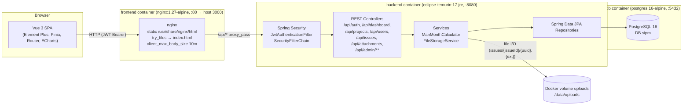
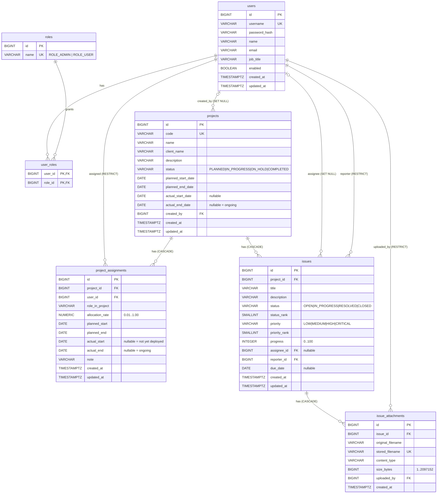
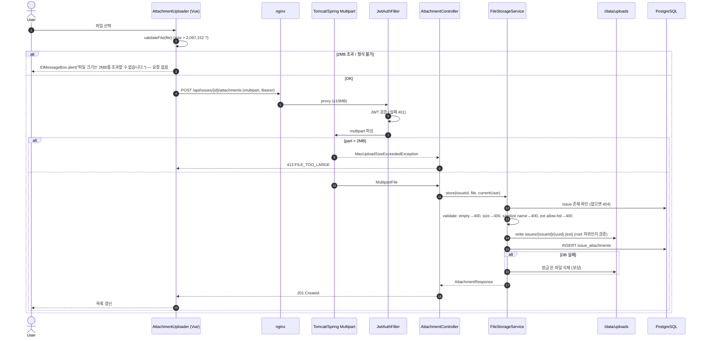
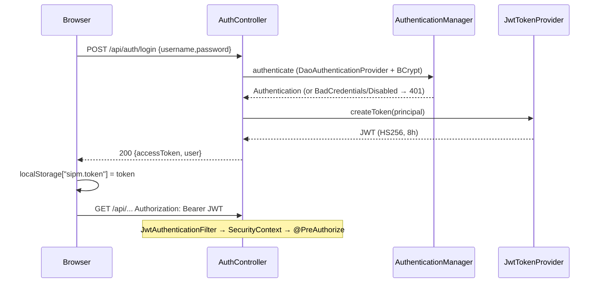

# SI Project Manager — 상세 설계서 (specs.md)

- 문서 버전: 1.0 (2026-10-23)
- 작성: Lead Software Architect
- 입력: `docs/requirements.md`
- 독자: Full-stack Engineer(구현), QA Engineer(검증)
- 규칙: 이 문서의 식별자(테이블/컬럼/엔드포인트/필드/에러코드/컴포넌트명)는 **그대로** 구현한다. 불가피한 변경은 문서 말미 `Implementation notes` 섹션에 사유와 함께 기록한다.

---

## 0. 전역 규약 (Global Conventions)

| 항목 | 규약 |
|---|---|
| Base package | `com.sipm` |
| JSON 필드 | camelCase, null 필드도 직렬화(`"actualEnd": null`) — Jackson `default-property-inclusion` 기본값(ALWAYS) 유지 |
| 날짜 | `LocalDate`, JSON `"yyyy-MM-dd"` |
| 월 | `YearMonth`, JSON/쿼리 `"yyyy-MM"` |
| 일시 | `OffsetDateTime`, ISO-8601 (`2026-10-23T09:00:00+09:00`) |
| 기준 시간대 | `Asia/Seoul`. "오늘(today)" = `LocalDate.now(ZoneId.of("Asia/Seoul"))`. 컨테이너 `TZ=Asia/Seoul` |
| ID | `BIGINT` identity, Java `Long` |
| MM(Man-Month) 수치 | 내부 계산 `BigDecimal`(scale 10, `RoundingMode.HALF_UP`), **응답 직전** 각 값마다 `setScale(2, HALF_UP)`. JSON number로 출력(예: `0.55`). 합계/누계는 **반올림 전 값**으로 계산 후 반올림 (§3.1) |
| 페이지 | 0-based `page` (Spring 기본). §4.2 |
| 파일 최대 크기 | `MAX_FILE_SIZE = 2 * 1024 * 1024 = 2,097,152 bytes` (정확히 2,097,152 bytes는 **허용**, 2,097,153부터 거부) |
| 언어 | UI 문구 한국어, 에러 `message` 한국어, `code`는 영문 상수 |

---

## 1. 개요 & 아키텍처

### 1.1 시스템 개요
SI 회사의 프로젝트별 인력 투입 현황을 관리하는 웹 애플리케이션.

- **대시보드** (모든 인증 사용자): 프로젝트별 투입 인원 수, 계획/실제 기간 요약, 차트.
- **Admin 콘솔** (`ROLE_ADMIN` 전용): 프로젝트 CRUD, 인원 할당(투입/철수일), 사용자 관리, 월별 타임시트(Grid/Gantt), 계획 vs 실제 시계열 비교.
- **이슈 관리** (모든 인증 사용자): Jira 유사 이슈 Grid(필터/정렬/페이지), 등록/수정 모달, 상세 Drawer, 첨부파일(2MB 제한).

### 1.2 기술 스택 (고정)

| 계층 | 기술 |
|---|---|
| Backend | Java 17, Spring Boot 3.3.x (3.3.5 권장), Spring Web, Spring Security, jjwt 0.12.6, Spring Data JPA (Hibernate 6), Bean Validation, Flyway 10, Maven (+ `mvnw`), spring-boot-starter-actuator(health만) |
| DB | PostgreSQL 16 (운영/compose). 백엔드 테스트는 H2 2.x (PostgreSQL mode) — §10.1 |
| Frontend | Vue 3.4+ (`<script setup>`, JavaScript), Vite 5, Pinia 2, Vue Router 4, Element Plus 2.x, `@element-plus/icons-vue`, axios 1.x, echarts 5.5 + vue-echarts 6.7, dayjs |
| FE Test | Vitest 1.6+/2.x, @vue/test-utils 2.4, jsdom |
| Runtime | Docker Compose: `db`, `backend`, `frontend`(nginx: SPA + `/api` reverse proxy) |

> Frontend는 **JavaScript**(TypeScript 미사용)로 작성한다. 빌드 위험 최소화 목적.

### 1.3 아키텍처 다이어그램



---

## 2. 데이터 모델

### 2.1 ERD



### 2.2 계획(Planned) vs 실제(Actual) 기간 구분

| 대상 | 계획 기간 (NOT NULL) | 실제 기간 (nullable) | 의미 |
|---|---|---|---|
| projects | `planned_start_date`, `planned_end_date` | `actual_start_date`, `actual_end_date` | 계획 공기 / 실제 착수·종료. `actual_end_date IS NULL` = 진행 중 |
| project_assignments | `planned_start`, `planned_end` | `actual_start`(투입일), `actual_end`(철수일) | `actual_start IS NULL` = 아직 미투입. `actual_end IS NULL` = 투입 중(ongoing) |

### 2.3 DDL — `backend/src/main/resources/db/migration/V1__init_schema.sql`

> **이식성 규칙**: 이 DDL은 PostgreSQL 16과 H2 2.x(`MODE=PostgreSQL`) 양쪽에서 그대로 실행되어야 한다(테스트 프로파일이 같은 Flyway 마이그레이션을 H2에서 실행). 따라서 `TEXT`, 정규식 CHECK, 부분/함수 인덱스, generated column, `now()`, 확장(extension)을 사용하지 않는다. `TIMESTAMP WITH TIME ZONE`, `CURRENT_TIMESTAMP`, `VARCHAR(n)` 사용.

```sql
-- ===== roles =====
CREATE TABLE roles (
    id    BIGINT GENERATED BY DEFAULT AS IDENTITY PRIMARY KEY,
    name  VARCHAR(30) NOT NULL,
    CONSTRAINT uk_roles_name UNIQUE (name),
    CONSTRAINT ck_roles_name CHECK (name IN ('ROLE_ADMIN', 'ROLE_USER'))
);

-- ===== users =====
CREATE TABLE users (
    id             BIGINT GENERATED BY DEFAULT AS IDENTITY PRIMARY KEY,
    username       VARCHAR(50)  NOT NULL,
    password_hash  VARCHAR(100) NOT NULL,
    name           VARCHAR(100) NOT NULL,
    email          VARCHAR(200),
    job_title      VARCHAR(50),
    enabled        BOOLEAN      NOT NULL DEFAULT TRUE,
    created_at     TIMESTAMP WITH TIME ZONE NOT NULL DEFAULT CURRENT_TIMESTAMP,
    updated_at     TIMESTAMP WITH TIME ZONE NOT NULL DEFAULT CURRENT_TIMESTAMP,
    CONSTRAINT uk_users_username UNIQUE (username)
);

-- ===== user_roles =====
CREATE TABLE user_roles (
    user_id  BIGINT NOT NULL,
    role_id  BIGINT NOT NULL,
    CONSTRAINT pk_user_roles PRIMARY KEY (user_id, role_id),
    CONSTRAINT fk_user_roles_user FOREIGN KEY (user_id) REFERENCES users (id) ON DELETE CASCADE,
    CONSTRAINT fk_user_roles_role FOREIGN KEY (role_id) REFERENCES roles (id) ON DELETE RESTRICT
);
CREATE INDEX ix_user_roles_role ON user_roles (role_id);

-- ===== projects =====
CREATE TABLE projects (
    id                  BIGINT GENERATED BY DEFAULT AS IDENTITY PRIMARY KEY,
    code                VARCHAR(30)  NOT NULL,
    name                VARCHAR(200) NOT NULL,
    client_name         VARCHAR(200),
    description         VARCHAR(4000),
    status              VARCHAR(20)  NOT NULL DEFAULT 'PLANNED',
    planned_start_date  DATE NOT NULL,
    planned_end_date    DATE NOT NULL,
    actual_start_date   DATE,
    actual_end_date     DATE,
    created_by          BIGINT,
    created_at          TIMESTAMP WITH TIME ZONE NOT NULL DEFAULT CURRENT_TIMESTAMP,
    updated_at          TIMESTAMP WITH TIME ZONE NOT NULL DEFAULT CURRENT_TIMESTAMP,
    CONSTRAINT uk_projects_code UNIQUE (code),
    CONSTRAINT ck_projects_status CHECK (status IN ('PLANNED', 'IN_PROGRESS', 'ON_HOLD', 'COMPLETED')),
    CONSTRAINT ck_projects_planned_period CHECK (planned_end_date >= planned_start_date),
    CONSTRAINT ck_projects_actual_period CHECK (
        actual_end_date IS NULL
        OR (actual_start_date IS NOT NULL AND actual_end_date >= actual_start_date)),
    CONSTRAINT fk_projects_created_by FOREIGN KEY (created_by) REFERENCES users (id) ON DELETE SET NULL
);
CREATE INDEX ix_projects_status ON projects (status);
CREATE INDEX ix_projects_planned_period ON projects (planned_start_date, planned_end_date);

-- ===== project_assignments =====
CREATE TABLE project_assignments (
    id               BIGINT GENERATED BY DEFAULT AS IDENTITY PRIMARY KEY,
    project_id       BIGINT       NOT NULL,
    user_id          BIGINT       NOT NULL,
    role_in_project  VARCHAR(50)  NOT NULL DEFAULT 'DEVELOPER',
    allocation_rate  NUMERIC(3,2) NOT NULL DEFAULT 1.00,
    planned_start    DATE NOT NULL,
    planned_end      DATE NOT NULL,
    actual_start     DATE,
    actual_end       DATE,
    note             VARCHAR(500),
    created_at       TIMESTAMP WITH TIME ZONE NOT NULL DEFAULT CURRENT_TIMESTAMP,
    updated_at       TIMESTAMP WITH TIME ZONE NOT NULL DEFAULT CURRENT_TIMESTAMP,
    CONSTRAINT uk_assignments_project_user UNIQUE (project_id, user_id),
    CONSTRAINT ck_assignments_allocation CHECK (allocation_rate > 0 AND allocation_rate <= 1.00),
    CONSTRAINT ck_assignments_planned_period CHECK (planned_end >= planned_start),
    CONSTRAINT ck_assignments_actual_period CHECK (
        actual_end IS NULL OR (actual_start IS NOT NULL AND actual_end >= actual_start)),
    CONSTRAINT fk_assignments_project FOREIGN KEY (project_id) REFERENCES projects (id) ON DELETE CASCADE,
    CONSTRAINT fk_assignments_user FOREIGN KEY (user_id) REFERENCES users (id) ON DELETE RESTRICT
);
CREATE INDEX ix_assignments_user ON project_assignments (user_id);
CREATE INDEX ix_assignments_planned ON project_assignments (planned_start, planned_end);
CREATE INDEX ix_assignments_actual ON project_assignments (actual_start, actual_end);

-- ===== issues =====
CREATE TABLE issues (
    id             BIGINT GENERATED BY DEFAULT AS IDENTITY PRIMARY KEY,
    project_id     BIGINT        NOT NULL,
    title          VARCHAR(200)  NOT NULL,
    description    VARCHAR(10000),
    status         VARCHAR(20)   NOT NULL DEFAULT 'OPEN',
    status_rank    SMALLINT      NOT NULL DEFAULT 1,
    priority       VARCHAR(20)   NOT NULL DEFAULT 'MEDIUM',
    priority_rank  SMALLINT      NOT NULL DEFAULT 2,
    progress       INTEGER       NOT NULL DEFAULT 0,
    assignee_id    BIGINT,
    reporter_id    BIGINT        NOT NULL,
    due_date       DATE,
    created_at     TIMESTAMP WITH TIME ZONE NOT NULL DEFAULT CURRENT_TIMESTAMP,
    updated_at     TIMESTAMP WITH TIME ZONE NOT NULL DEFAULT CURRENT_TIMESTAMP,
    CONSTRAINT ck_issues_title CHECK (LENGTH(TRIM(title)) > 0),
    CONSTRAINT ck_issues_status CHECK (status IN ('OPEN', 'IN_PROGRESS', 'RESOLVED', 'CLOSED')),
    CONSTRAINT ck_issues_status_rank CHECK (status_rank BETWEEN 1 AND 4),
    CONSTRAINT ck_issues_priority CHECK (priority IN ('LOW', 'MEDIUM', 'HIGH', 'CRITICAL')),
    CONSTRAINT ck_issues_priority_rank CHECK (priority_rank BETWEEN 1 AND 4),
    CONSTRAINT ck_issues_progress CHECK (progress BETWEEN 0 AND 100),
    CONSTRAINT fk_issues_project FOREIGN KEY (project_id) REFERENCES projects (id) ON DELETE CASCADE,
    CONSTRAINT fk_issues_assignee FOREIGN KEY (assignee_id) REFERENCES users (id) ON DELETE SET NULL,
    CONSTRAINT fk_issues_reporter FOREIGN KEY (reporter_id) REFERENCES users (id) ON DELETE RESTRICT
);
CREATE INDEX ix_issues_project_created ON issues (project_id, created_at DESC);
CREATE INDEX ix_issues_status ON issues (status);
CREATE INDEX ix_issues_priority ON issues (priority);
CREATE INDEX ix_issues_assignee ON issues (assignee_id);
CREATE INDEX ix_issues_reporter ON issues (reporter_id);

-- ===== issue_attachments =====
CREATE TABLE issue_attachments (
    id                 BIGINT GENERATED BY DEFAULT AS IDENTITY PRIMARY KEY,
    issue_id           BIGINT       NOT NULL,
    original_filename  VARCHAR(255) NOT NULL,
    stored_filename    VARCHAR(100) NOT NULL,
    content_type       VARCHAR(100) NOT NULL,
    size_bytes         BIGINT       NOT NULL,
    uploaded_by        BIGINT       NOT NULL,
    created_at         TIMESTAMP WITH TIME ZONE NOT NULL DEFAULT CURRENT_TIMESTAMP,
    CONSTRAINT uk_attachments_stored_filename UNIQUE (stored_filename),
    CONSTRAINT ck_attachments_size CHECK (size_bytes > 0 AND size_bytes <= 2097152),
    CONSTRAINT fk_attachments_issue FOREIGN KEY (issue_id) REFERENCES issues (id) ON DELETE CASCADE,
    CONSTRAINT fk_attachments_uploader FOREIGN KEY (uploaded_by) REFERENCES users (id) ON DELETE RESTRICT
);
CREATE INDEX ix_attachments_issue ON issue_attachments (issue_id);
```

**ON DELETE 정책 요약**

| FK | 동작 | 이유 |
|---|---|---|
| user_roles → users | CASCADE | 사용자 삭제 시 매핑 제거 (단, 사용자 삭제 API 없음: 비활성화만) |
| user_roles → roles | RESTRICT | 역할은 고정 데이터 |
| projects.created_by → users | SET NULL | 감사 정보 |
| project_assignments → projects | CASCADE | 프로젝트 삭제 시 할당 제거 |
| project_assignments → users | RESTRICT | 투입 이력이 있는 사용자 물리 삭제 금지 |
| issues → projects | CASCADE | 프로젝트 삭제 시 이슈 제거 (첨부 **파일**은 서비스가 커밋 후 디렉터리 삭제, §7.6) |
| issues.assignee_id → users | SET NULL | |
| issues.reporter_id → users | RESTRICT | |
| issue_attachments → issues | CASCADE | 파일은 서비스가 커밋 후 삭제 |
| issue_attachments.uploaded_by → users | RESTRICT | |

**Rank 컬럼** (정렬용, 엔티티 `@PrePersist/@PreUpdate`에서 enum으로부터 설정):

| status | status_rank | priority | priority_rank |
|---|---|---|---|
| OPEN | 1 | LOW | 1 |
| IN_PROGRESS | 2 | MEDIUM | 2 |
| RESOLVED | 3 | HIGH | 3 |
| CLOSED | 4 | CRITICAL | 4 |

**JPA 매핑 메모**
- `spring.jpa.hibernate.ddl-auto=validate` (default 프로파일), `none` (test 프로파일). 스키마는 오직 Flyway가 관리.
- enum은 `@Enumerated(EnumType.STRING)`.
- `allocation_rate` → `BigDecimal` (`@Column(precision=3, scale=2)`).
- `created_at/updated_at` → `@CreationTimestamp`/`@UpdateTimestamp` `OffsetDateTime`.
- `User.roles` → `@ManyToMany(fetch = EAGER)` via `user_roles`.
- 연관관계는 `LAZY` 기본, 목록 조회 시 N+1 방지: issue 목록은 `@EntityGraph(attributePaths={"project","assignee","reporter"})` 또는 fetch join + 별도 count 쿼리.
- `Issue.attachmentCount` → `@Formula("(select count(*) from issue_attachments a where a.issue_id = id)")`.

### 2.4 Seed — `V2__seed_data.sql`

> 이식성 규칙 동일. ID를 명시하지 않고 `INSERT ... SELECT`로 username/code 조회해 FK를 채운다(identity 시퀀스 충돌 방지).
> 비밀번호 해시는 BCrypt cost 10 (아래 값은 실제 생성값. Engineer는 `PasswordEncoder.matches` 단위 테스트로 검증할 것).
> - `admin1234` → `$2a$10$Dak9d7683Dss68Ylb/bGHus.HBLbIV.OBWHmVqeGDIItvxBmLVnF.`
> - `user1234` → `$2a$10$MuKHA9p4Q7ve.uvmYuUO4Ok57q7WfywUh.n.rIJ44/OiBHj7gb97a`
> (htpasswd `$2y$`로 생성 후 접두어만 `$2a$`로 치환. 동일 알고리즘이며 Spring `BCryptPasswordEncoder`는 두 접두어 모두 지원.)

| username | password | name | roles | job_title |
|---|---|---|---|---|
| admin | admin1234 | 관리자 | ROLE_ADMIN, ROLE_USER | PMO |
| user | user1234 | 일반사용자 | ROLE_USER | 사원 |
| kim | user1234 | 김철수 | ROLE_USER | 과장 |
| lee | user1234 | 이영희 | ROLE_USER | 대리 |

| code | name | client_name | status | planned | actual |
|---|---|---|---|---|---|
| SI-2026-001 | 차세대 ERP 구축 | A제조 | IN_PROGRESS | 2026-01-01 ~ 2026-03-31 | 2026-01-15 ~ (null) |
| SI-2026-002 | 물류 MES 고도화 | B물류 | PLANNED | 2026-03-01 ~ 2026-06-30 | (null) ~ (null) |

| # | project | user | role_in_project | allocation | planned | actual |
|---|---|---|---|---|---|---|
| A1 | SI-2026-001 | kim | PM | 1.00 | 2026-01-01 ~ 2026-03-31 | 2026-01-15 ~ 2026-03-31 |
| A2 | SI-2026-001 | lee | DEVELOPER | 0.50 | 2026-02-01 ~ 2026-03-31 | 2026-02-01 ~ (null) |
| A3 | SI-2026-002 | kim | ARCHITECT | 0.50 | 2026-03-16 ~ 2026-04-30 | (null) ~ (null) |

이 데이터는 §3.6 Worked Example과 **동일**하다. QA는 시드 상태 그대로 API를 호출해 수치를 검증할 수 있다.

Issues (SI-2026-001, reporter=admin):
1. "로그인 화면 오류" / OPEN / HIGH / progress 0 / assignee kim / due 2026-03-20
2. "주문 API 성능 개선" / IN_PROGRESS / MEDIUM / progress 40 / assignee lee
3. "배포 스크립트 정리" / RESOLVED / LOW / progress 100 / assignee null

`status_rank`, `priority_rank`도 시드 SQL에 명시적으로 넣는다(트리거 없음).

---

## 3. 계산 지표 (Computed Metrics) — 정확한 정의

모든 계산은 `com.sipm.metrics.ManMonthCalculator` (Spring 의존성 없는 순수 클래스, static 또는 무상태 bean)에 구현하고, Dashboard/Timesheet/Plan-vs-Actual 서비스가 이를 공유한다.

### 3.1 공통 기본 정의

- **일수 계산은 달력일(calendar day)** 기준(주말/공휴일 포함). 양 끝 날짜 포함(inclusive).
- `days(a, b)` = `b - a + 1` (a ≤ b), 그 외 0.
- 월 `m`: `monthStart(m)` = 1일, `monthEnd(m)` = 말일, `D(m)` = 해당 월 일수(윤년 반영, 2026-02 = 28).
- **겹침 일수** `overlap(s, e, m)` = `days(max(s, monthStart(m)), min(e, monthEnd(m)))`.
- **할당 월 MM**: `MM(a, m, s, e) = allocation_rate(a) × overlap(s, e, m) / D(m)`.
  - 부분 월 비례 배분(proration): 해당 월 투입 일수 ÷ 해당 월 전체 달력일수.
  - 예: 1월 15일~31일 전일 투입(1.00) → 17/31 = 0.548387… → 표시 0.55.
- **정밀도/반올림 규칙 (QA 검증 기준)**:
  1. 개별 MM은 `BigDecimal`로 `allocation × overlapDays` 를 `D(m)`로 나눌 때 `scale 10, HALF_UP`.
  2. 모든 합계(사용자 월합, 월 총합, 행 합계, 누계, 차이)는 **반올림하지 않은 값**을 더하고/빼서 구한다.
  3. 응답에 담는 **각 숫자**를 마지막에 독립적으로 `setScale(2, HALF_UP)`.
  4. 따라서 "표시된 월 값들의 합"과 "표시된 합계"가 0.01 차이 날 수 있다(정상). 예: §3.6의 0.55+1.50+0.73=2.78 vs 누계 2.77.

### 3.2 기간 기준(basis)별 유효 기간

| basis | 시작 s | 종료 e | 미포함 조건 |
|---|---|---|---|
| PLAN | `planned_start` | `planned_end` | 없음 |
| ACTUAL | `actual_start` | `min(coalesce(actual_end, asOf), asOf)` | `actual_start IS NULL` 또는 `actual_start > asOf` → 기여 0 |

- `asOf`: 기준일. 쿼리 파라미터 `asOf`(yyyy-MM-dd)로 지정, 생략 시 today(Asia/Seoul).
- ACTUAL은 **미래를 계산하지 않는다**: `actual_end`가 asOf 이후로 입력돼 있어도 asOf에서 자른다.
- 프로젝트의 계획/실제 기간은 MM 계산에 쓰이지 않는다(MM은 오직 assignment 기간). 프로젝트 기간은 검증(§5)과 기간 요약(duration)에만 사용.

### 3.3 프로젝트별 투입 인원 수 (Headcount)

프로젝트 p, 기준일 asOf에 대해:

| 지표 | 정의 |
|---|---|
| `assignedHeadcount` | p의 assignment 수 (= distinct user 수, `UNIQUE(project_id,user_id)`이므로 동일). 날짜 무관 |
| `activeHeadcount` | `actual_start IS NOT NULL AND actual_start <= asOf AND (actual_end IS NULL OR actual_end >= asOf)` 인 assignment 수 |
| `plannedActiveHeadcount` | `planned_start <= asOf AND planned_end >= asOf` 인 assignment 수 |
| `totalPlannedMM` | p의 모든 assignment에 대해 PLAN 기준 MM을 **전 기간** 합 = Σ allocation × Σ_m overlap/D(m) |
| `actualMMToDate` | p의 모든 assignment의 ACTUAL 기준 MM 전 기간 합(asOf까지) |
| `plannedMMToDate` | PLAN 기준이되 종료를 `min(planned_end, asOf)`로 자른 MM 합 (planned_start > asOf면 0) |
| `plannedDurationDays` | `days(planned_start_date, planned_end_date)` (프로젝트) |
| `actualDurationDays` | `actual_start_date`가 null이거나 > asOf면 `null`, 아니면 `days(actual_start_date, min(coalesce(actual_end_date, asOf), asOf))` |

대시보드 요약의 `activePersonnel` = asOf 기준 active 조건을 만족하는 assignment들의 **distinct user_id 수**(여러 프로젝트에 동시 투입돼도 1명).

### 3.4 월별 타임시트 (Monthly Timesheet)

입력: `from`(yyyy-MM), `to`(yyyy-MM), `basis`(PLAN|ACTUAL), `projectId`(optional), `asOf`.

- 월 목록 `months` = from..to (양끝 포함, 오름차순).
- **대상 assignment**: (projectId 지정 시 해당 프로젝트만) 그리고 basis 유효 기간 [s,e]가 존재하며 `[monthStart(from), monthEnd(to)]`와 1일 이상 겹치는 것.
- 셀 `cell(u, a, m)` = `MM(a, m, s, e)` (basis 기준).
- 사용자 월합 `userMonth(u, m)` = Σ_a∈u cell. 사용자 합계 `userTotal(u)` = Σ_m userMonth.
- assignment 행 합계 = Σ_m cell.
- 월 총합 `monthTotal(m)` = Σ_u userMonth(u,m). `grandTotal` = Σ_m monthTotal.
- **과다 할당** `overAllocatedMonths(u)` = userMonth(u,m) > 1.00 인 m 목록(반올림 전 값으로 비교).
- 대상 assignment가 하나도 없는 사용자는 rows에서 제외. 셀은 항상 숫자(0 포함, null 아님).
- rows 정렬: user `name` 오름차순, 그 안의 projects는 `projectCode` 오름차순.

### 3.5 계획 vs 실제 시계열 (Plan vs Actual)

입력: `projectId`(optional, 생략=전체 프로젝트), `from`, `to`(optional), `asOf`.

- 대상 assignment = 지정 프로젝트(들)의 모든 assignment.
- 월 m마다:
  - `plannedMM(m)` = Σ_a MM(a, m) [PLAN 기준]
  - `actualMM(m)` = Σ_a MM(a, m) [ACTUAL 기준]. **단 `monthStart(m) > asOf`이면 `null`** (미래 월은 실제값 없음).
  - `cumulativePlannedMM(m)` = Σ_{k=from..m} plannedMM(k)  — 누계는 `from` 월에서 0부터 시작.
  - `cumulativeActualMM(m)` = Σ_{k=from..m} actualMM(k); actualMM(m)이 null이면 null.
  - `varianceMM(m)` = actualMM(m) − plannedMM(m) (actual null이면 null).
  - `cumulativeVarianceMM(m)` = cumulativeActualMM(m) − cumulativePlannedMM(m) (null이면 null).
- **기본 범위**(from/to 생략 시):
  - `from` = 대상 프로젝트들의 `min(planned_start_date, actual_start_date, 대상 assignment의 planned_start/actual_start)`의 월.
  - `to` = `max(planned_end_date, 대상 assignment의 planned_end, ACTUAL 유효 종료일)`의 월.
  - 대상 프로젝트/assignment가 없으면 `series: []`.
- `summary` (from/to 범위와 무관하게 전 기간 기준):
  - `totalPlannedMM`, `plannedMMToDate`, `actualMMToDate` — §3.3 정의를 대상 프로젝트들에 대해 합산.
  - `scheduleVarianceMM` = `actualMMToDate − plannedMMToDate`.
  - `plannedDurationDays`, `actualDurationDays` — projectId 지정 시에만 값, 전체 조회 시 `null`.
- 검증: `from > to` → 400, 범위 > 60개월 → 400 (§5).

### 3.6 Worked Example (QA 검증 기준값 — 시드 데이터와 동일)

전제: 2026년은 평년. D(2026-01)=31, D(2026-02)=28, D(2026-03)=31, D(2026-04)=30. **asOf = 2026-03-15**.

| 할당 | 사용자 | 프로젝트 | alloc | planned | actual | ACTUAL 유효 기간(asOf 적용) |
|---|---|---|---|---|---|---|
| A1 | kim | P1 (SI-2026-001) | 1.00 | 01-01 ~ 03-31 | 01-15 ~ 03-31 | 01-15 ~ 03-15 |
| A2 | lee | P1 | 0.50 | 02-01 ~ 03-31 | 02-01 ~ null | 02-01 ~ 03-15 |
| A3 | kim | P2 (SI-2026-002) | 0.50 | 03-16 ~ 04-30 | null | (미투입, 0) |

**(a) 할당별 월 MM — 정확값(분수) → 표시값**

| 할당 | basis | 2026-01 | 2026-02 | 2026-03 | 2026-04 |
|---|---|---|---|---|---|
| A1 | PLAN | 31/31 = 1.00 | 28/28 = 1.00 | 31/31 = 1.00 | 0 |
| A2 | PLAN | 0 | 0.5×28/28 = 0.50 | 0.5×31/31 = 0.50 | 0 |
| A3 | PLAN | 0 | 0 | 0.5×16/31 = 0.258064… → 0.26 | 0.5×30/30 = 0.50 |
| A1 | ACTUAL | 17/31 = 0.548387… → 0.55 | 1.00 | 15/31 = 0.483870… → 0.48 | 0 |
| A2 | ACTUAL | 0 | 0.50 | 0.5×15/31 = 0.241935… → 0.24 | 0 |
| A3 | ACTUAL | 0 | 0 | 0 | 0 |

**(b) Plan vs Actual — `GET /api/admin/plan-vs-actual?projectId={P1}&from=2026-01&to=2026-04&asOf=2026-03-15`**

| month | plannedMM | actualMM | cumulativePlannedMM | cumulativeActualMM | varianceMM | cumulativeVarianceMM |
|---|---|---|---|---|---|---|
| 2026-01 | 1.00 | 0.55 (17/31) | 1.00 | 0.55 | -0.45 (−14/31) | -0.45 |
| 2026-02 | 1.50 | 1.50 | 2.50 | 2.05 (2.048387) | 0.00 | -0.45 (−0.451613) |
| 2026-03 | 1.50 | 0.73 (22.5/31=0.725806) | 4.00 | 2.77 (2.774194) | -0.77 (−0.774194) | -1.23 (−1.225806) |
| 2026-04 | 0.00 | null | 4.00 | null | null | null |

summary: `totalPlannedMM=4.00`, `plannedMMToDate=3.23`, `actualMMToDate=2.77`, `scheduleVarianceMM=-0.45`, `plannedDurationDays=90`, `actualDurationDays=60`.
- plannedMMToDate 상세: A1 01-01~03-15 = 1 + 1 + 15/31 = 2.483871; A2 02-01~03-15 = 0.5 + 0.5×15/31 = 0.741935; 합 3.225806 → **3.23**.
- actualMMToDate = 17/31 + 1 + 15/31 + 0.5 + 7.5/31 = 2.774194 → **2.77**.
- scheduleVariance = 2.774194 − 3.225806 = −0.451613 → **-0.45**.
- plannedDurationDays = days(01-01, 03-31) = 31+28+31 = **90**. actualDurationDays = days(01-15, 03-15) = 17+28+15 = **60**.
- 반올림 규칙 확인: 표시된 actualMM 합 0.55+1.50+0.73 = 2.78 이지만 cumulativeActualMM(03) = **2.77** (반올림 전 합산이 정답).

전체 프로젝트(`projectId` 생략, from=2026-01, to=2026-04, asOf=2026-03-15): plannedMM = [1.00, 1.50, 1.76 (1.758065), 0.50], actualMM = [0.55, 1.50, 0.73, null], cumulativePlannedMM = [1.00, 2.50, 4.26 (4.258065), 4.76 (4.758065)], summary.totalPlannedMM = 4.76, plannedMMToDate = 3.23 (A3는 03-16 시작이라 0), actualMMToDate = 2.77.

**(c) Timesheet — `GET /api/admin/timesheet?from=2026-01&to=2026-04&basis=PLAN`**

| user | project | 01 | 02 | 03 | 04 | total |
|---|---|---|---|---|---|---|
| 김철수(kim) | SI-2026-001 (A1) | 1.00 | 1.00 | 1.00 | 0.00 | 3.00 |
| 김철수(kim) | SI-2026-002 (A3) | 0.00 | 0.00 | 0.26 | 0.50 | 0.76 (0.758065) |
| **김철수 소계** | | 1.00 | 1.00 | **1.26** (1.258065) | 0.50 | 3.76 (3.758065) |
| 이영희(lee) | SI-2026-001 (A2) | 0.00 | 0.50 | 0.50 | 0.00 | 1.00 |
| **월 총합** | | 1.00 | 1.50 | 1.76 | 0.50 | **4.76** |

- kim `overAllocatedMonths = ["2026-03"]` (1.258065 > 1). lee `[]`.
- rows 순서: name 오름차순 → "김철수", "이영희".

**`basis=ACTUAL&asOf=2026-03-15`** (A3는 actual_start null → 제외)

| user | project | 01 | 02 | 03 | 04 | total |
|---|---|---|---|---|---|---|
| 김철수 | SI-2026-001 | 0.55 | 1.00 | 0.48 | 0.00 | 2.03 (2.032258) |
| 이영희 | SI-2026-001 | 0.00 | 0.50 | 0.24 | 0.00 | 0.74 (0.741935) |
| 월 총합 | | 0.55 | 1.50 | 0.73 | 0.00 | **2.77** |

**(d) Dashboard — `GET /api/dashboard/projects?asOf=2026-03-15`**

| code | assignedHeadcount | activeHeadcount | plannedActiveHeadcount | totalPlannedMM | actualMMToDate | plannedDurationDays | actualDurationDays |
|---|---|---|---|---|---|---|---|
| SI-2026-001 | 2 | 2 | 2 | 4.00 | 2.77 | 90 | 60 |
| SI-2026-002 | 1 | 0 | 0 | 0.76 | 0.00 | 122 | null |

- SI-2026-002 plannedDurationDays = days(03-01, 06-30) = 31+30+31+30 = 122.
- `GET /api/dashboard/summary?asOf=2026-03-15` → `activePersonnel = 2`, `totalProjects = 2`.
- 보조 케이스: asOf=2026-04-01 → SI-2026-001 activeHeadcount = 1 (A1 actual_end 03-31 < 04-01, A2 ongoing), plannedActiveHeadcount = 0.

---

## 4. REST API 명세

### 4.1 공통 에러 응답

모든 4xx/5xx(보안 필터에서 발생하는 401/403 포함)는 아래 JSON(`Content-Type: application/json`)을 반환한다.

```json
{
  "timestamp": "2026-10-23T10:15:30.123+09:00",
  "status": 400,
  "error": "Bad Request",
  "code": "VALIDATION_ERROR",
  "message": "입력값이 올바르지 않습니다.",
  "path": "/api/admin/projects",
  "fieldErrors": [
    { "field": "plannedEndDate", "code": "DATE_RANGE", "message": "종료일은 시작일과 같거나 이후여야 합니다.", "rejectedValue": "2026-01-01" }
  ]
}
```
`fieldErrors`는 항상 배열(없으면 `[]`).

**에러 코드 표**

| HTTP | code | 상황 |
|---|---|---|
| 400 | `VALIDATION_ERROR` | Bean Validation / 날짜 순서 / 쿼리 파라미터 형식 오류 (fieldErrors 포함) |
| 400 | `INVALID_SORT` | 허용되지 않은 sort 필드/방향 |
| 400 | `ASSIGNMENT_OUT_OF_PROJECT_PERIOD` | 할당 계획 기간이 프로젝트 계획 기간을 벗어남 (fieldErrors: `plannedStart`/`plannedEnd`) |
| 400 | `USER_DISABLED` | 비활성 사용자를 할당/담당자로 지정 |
| 400 | `SELF_MODIFICATION_NOT_ALLOWED` | 관리자가 자신을 비활성화하거나 자신의 ROLE_ADMIN 제거 |
| 400 | `FILE_EMPTY` | 0바이트 파일 또는 `file` 파트 누락 |
| 400 | `FILE_TOO_LARGE` | 서비스 계층에서 size > 2,097,152 감지 (멀티파트 한도를 우회한 경우, 예: MockMvc) |
| 400 | `FILE_TYPE_NOT_ALLOWED` | 확장자 allow-list 위반 |
| 400 | `INVALID_FILENAME` | 정제 후 파일명이 비었거나 `.`/`..` |
| 401 | `UNAUTHORIZED` | 토큰 없음/만료/위조 |
| 401 | `BAD_CREDENTIALS` | 로그인 실패 |
| 401 | `ACCOUNT_DISABLED` | 비활성 계정 로그인 |
| 403 | `FORBIDDEN` | 권한 부족 (USER → admin API, 타인 이슈/첨부 삭제) |
| 404 | `NOT_FOUND` | 리소스 없음 (`message`에 리소스 명시) |
| 409 | `DUPLICATE_USERNAME` / `DUPLICATE_PROJECT_CODE` / `DUPLICATE_ASSIGNMENT` | UNIQUE 위반 |
| 409 | `PROJECT_PERIOD_CONFLICT` | 프로젝트 계획 기간 수정 시 기존 할당이 범위 밖이 됨 |
| 409 | `DATA_INTEGRITY_VIOLATION` | 기타 DB 제약 위반(`DataIntegrityViolationException`) |
| 413 | `FILE_TOO_LARGE` | `MaxUploadSizeExceededException` (Spring multipart 한도 초과) |
| 500 | `INTERNAL_ERROR` | 그 외 |

> **주의(구현)**: `@RestControllerAdvice`에 `Exception` 포괄 핸들러를 둘 경우 `AccessDeniedException`(메서드 보안 `@PreAuthorize`에서 발생)과 `AuthenticationException`을 반드시 **별도 핸들러로 403/401** 처리해야 한다(포괄 핸들러가 500으로 바꾸는 버그 방지). 필터 단계 401/403은 커스텀 `AuthenticationEntryPoint`/`AccessDeniedHandler`가 같은 JSON 포맷을 쓴다.
> `MethodArgumentTypeMismatchException`(예: `asOf=abc`, `status=FOO`)과 `MissingServletRequestParameterException`, `HttpMessageNotReadableException`(잘못된 JSON/enum)은 400 `VALIDATION_ERROR`.

### 4.2 페이지네이션 / 정렬

요청 쿼리: `page`(0-based, 기본 0, 최소 0), `size`(기본 20, 1..100, 초과 시 100으로 clamp), `sort`(`field,asc|desc`, 반복 가능. 기본 엔드포인트별 정의).

응답(`PageResponse<T>` DTO — Spring `Page`를 직접 직렬화하지 않는다):
```json
{ "content": [ ... ], "totalElements": 57, "totalPages": 3, "page": 0, "size": 20 }
```
허용되지 않은 sort 필드 → 400 `INVALID_SORT`. sort 필드명은 API 필드명이며 서버가 엔티티 속성으로 매핑한다(아래 각 API의 허용 목록).

### 4.3 공통 DTO

```jsonc
// UserSummary
{ "id": 3, "username": "kim", "name": "김철수" }

// UserResponse
{ "id": 3, "username": "kim", "name": "김철수", "email": "kim@example.com", "jobTitle": "과장",
  "enabled": true, "roles": ["ROLE_USER"], "createdAt": "2026-10-23T09:00:00+09:00" }

// ProjectSummary
{ "id": 1, "code": "SI-2026-001", "name": "차세대 ERP 구축", "status": "IN_PROGRESS",
  "plannedStartDate": "2026-01-01", "plannedEndDate": "2026-03-31" }

// ProjectResponse
{ "id": 1, "code": "SI-2026-001", "name": "차세대 ERP 구축", "clientName": "A제조", "description": null,
  "status": "IN_PROGRESS",
  "plannedStartDate": "2026-01-01", "plannedEndDate": "2026-03-31",
  "actualStartDate": "2026-01-15", "actualEndDate": null,
  "assignedHeadcount": 2,
  "createdAt": "...", "updatedAt": "..." }

// AssignmentResponse
{ "id": 1, "projectId": 1, "user": { "id": 3, "username": "kim", "name": "김철수" },
  "roleInProject": "PM", "allocationRate": 1.00,
  "plannedStart": "2026-01-01", "plannedEnd": "2026-03-31",
  "actualStart": "2026-01-15", "actualEnd": "2026-03-31",
  "state": "ACTIVE", "note": null }
// state (today 기준 파생): actualStart==null || actualStart>today → "PLANNED";
//                         actualEnd!=null && actualEnd<today → "RELEASED"; 그 외 "ACTIVE"

// IssueListItem
{ "id": 10, "projectId": 1, "projectCode": "SI-2026-001", "projectName": "차세대 ERP 구축",
  "title": "로그인 화면 오류", "status": "OPEN", "priority": "HIGH", "progress": 0,
  "assignee": { "id": 3, "username": "kim", "name": "김철수" },   // nullable
  "reporter": { "id": 1, "username": "admin", "name": "관리자" },
  "dueDate": "2026-03-20", "attachmentCount": 0,
  "createdAt": "...", "updatedAt": "..." }

// IssueDetail = IssueListItem + { "description": "...", "attachments": [AttachmentResponse] }

// AttachmentResponse
{ "id": 5, "issueId": 10, "originalFilename": "스펙.pdf", "contentType": "application/pdf",
  "sizeBytes": 1048576, "uploadedBy": { "id": 1, "username": "admin", "name": "관리자" },
  "createdAt": "..." }
```

Enum 값: `ProjectStatus = PLANNED|IN_PROGRESS|ON_HOLD|COMPLETED`, `IssueStatus = OPEN|IN_PROGRESS|RESOLVED|CLOSED`, `IssuePriority = LOW|MEDIUM|HIGH|CRITICAL`, `Basis = PLAN|ACTUAL`, `Role = ROLE_ADMIN|ROLE_USER`.

### 4.4 엔드포인트 목록 (총 29개)

| # | Method | Path | Role | 설명 |
|---|---|---|---|---|
| 1 | POST | `/api/auth/login` | public | 로그인 |
| 2 | GET | `/api/auth/me` | auth | 내 정보 |
| 3 | GET | `/api/dashboard/summary` | auth | 요약 카드 |
| 4 | GET | `/api/dashboard/projects` | auth | 프로젝트별 인원/기간 |
| 5 | GET | `/api/projects` | auth | 프로젝트 lookup |
| 6 | GET | `/api/users` | auth | 사용자 lookup (담당자 선택) |
| 7 | GET | `/api/admin/projects` | ADMIN | 프로젝트 목록(페이지) |
| 8 | GET | `/api/admin/projects/{id}` | ADMIN | 프로젝트 상세 |
| 9 | POST | `/api/admin/projects` | ADMIN | 프로젝트 생성 |
| 10 | PUT | `/api/admin/projects/{id}` | ADMIN | 프로젝트 수정 |
| 11 | DELETE | `/api/admin/projects/{id}` | ADMIN | 프로젝트 삭제 |
| 12 | GET | `/api/admin/projects/{id}/assignments` | ADMIN | 할당 목록 |
| 13 | POST | `/api/admin/projects/{id}/assignments` | ADMIN | 인원 할당(리소스 추가) |
| 14 | PUT | `/api/admin/projects/{id}/assignments/{assignmentId}` | ADMIN | 할당 수정(투입/철수일) |
| 15 | DELETE | `/api/admin/projects/{id}/assignments/{assignmentId}` | ADMIN | 리소스 제외 |
| 16 | GET | `/api/admin/users` | ADMIN | 사용자 목록(페이지) |
| 17 | POST | `/api/admin/users` | ADMIN | 사용자 생성 |
| 18 | PUT | `/api/admin/users/{id}` | ADMIN | 사용자 수정/비활성화 |
| 19 | GET | `/api/admin/timesheet` | ADMIN | 월별 타임시트 |
| 20 | GET | `/api/admin/plan-vs-actual` | ADMIN | 계획 vs 실제 시계열 |
| 21 | GET | `/api/issues` | auth | 이슈 Grid |
| 22 | GET | `/api/issues/{id}` | auth | 이슈 상세 |
| 23 | POST | `/api/issues` | auth | 이슈 생성 |
| 24 | PUT | `/api/issues/{id}` | auth | 이슈 수정 |
| 25 | DELETE | `/api/issues/{id}` | reporter 또는 ADMIN | 이슈 삭제 |
| 26 | POST | `/api/issues/{issueId}/attachments` | auth | 첨부 업로드 (multipart) |
| 27 | GET | `/api/issues/{issueId}/attachments` | auth | 첨부 목록 |
| 28 | GET | `/api/attachments/{id}/download` | auth | 첨부 다운로드 |
| 29 | DELETE | `/api/attachments/{id}` | uploader 또는 ADMIN | 첨부 삭제 |

"auth" = 유효한 JWT를 가진 사용자(ROLE_USER 또는 ROLE_ADMIN). 모든 엔드포인트 공통 에러: 401 `UNAUTHORIZED`(public 제외), 500 `INTERNAL_ERROR`.

### 4.5 Auth

#### 1. `POST /api/auth/login`
Request:
```json
{ "username": "admin", "password": "admin1234" }
```
| 필드 | 규칙 |
|---|---|
| username | `@NotBlank`, max 50 |
| password | `@NotBlank`, max 100 |

Response 200:
```json
{ "accessToken": "eyJhbGciOiJIUzI1NiJ9...", "tokenType": "Bearer", "expiresIn": 28800,
  "user": { "id": 1, "username": "admin", "name": "관리자", "email": null, "jobTitle": "PMO",
            "enabled": true, "roles": ["ROLE_ADMIN", "ROLE_USER"], "createdAt": "..." } }
```
Errors: 400 `VALIDATION_ERROR`, 401 `BAD_CREDENTIALS`(존재하지 않는 사용자/비밀번호 불일치 동일 메시지 "아이디 또는 비밀번호가 올바르지 않습니다."), 401 `ACCOUNT_DISABLED`.

#### 2. `GET /api/auth/me`
Response 200: `UserResponse`. Errors: 401.

### 4.6 Dashboard

#### 3. `GET /api/dashboard/summary`
Query: `asOf` (date, optional, 기본 today).
Response 200:
```json
{ "asOf": "2026-03-15",
  "totalProjects": 2,
  "projectsByStatus": { "PLANNED": 1, "IN_PROGRESS": 1, "ON_HOLD": 0, "COMPLETED": 0 },
  "activePersonnel": 2,
  "totalAssignments": 3,
  "openIssues": 2 }
```
- `projectsByStatus`: 4개 키 모두 항상 포함(0 포함).
- `openIssues` = status ∈ {OPEN, IN_PROGRESS} 이슈 수.
- `totalAssignments` = 전체 assignment 수.

#### 4. `GET /api/dashboard/projects`
Query: `asOf` (optional), `status` (ProjectStatus, optional).
Response 200 (배열, `plannedStartDate` asc, 동률 시 `code` asc):
```json
[
  { "id": 1, "code": "SI-2026-001", "name": "차세대 ERP 구축", "clientName": "A제조", "status": "IN_PROGRESS",
    "plannedStartDate": "2026-01-01", "plannedEndDate": "2026-03-31",
    "actualStartDate": "2026-01-15", "actualEndDate": null,
    "plannedDurationDays": 90, "actualDurationDays": 60,
    "assignedHeadcount": 2, "activeHeadcount": 2, "plannedActiveHeadcount": 2,
    "totalPlannedMM": 4.00, "plannedMMToDate": 3.23, "actualMMToDate": 2.77 }
]
```
Errors: 400 (`asOf`/`status` 형식).

### 4.7 Lookup (모든 인증 사용자)

#### 5. `GET /api/projects`
Query: 없음. Response 200: `ProjectSummary[]`, `code` asc. (이슈 필터/등록용)

#### 6. `GET /api/users`
Query: `keyword` (optional; username/name 부분일치, 대소문자 무시). Response 200: `UserSummary[]`, **enabled 사용자만**, `name` asc.

### 4.8 Admin — Projects (`@PreAuthorize("hasRole('ADMIN')")` 클래스 레벨)

#### 7. `GET /api/admin/projects`
Query: `page`, `size`, `sort`(기본 `plannedStartDate,desc`; 허용: `id, code, name, status, plannedStartDate, plannedEndDate, actualStartDate, createdAt`), `keyword`(code/name/clientName 부분일치), `status`.
Response 200: `PageResponse<ProjectResponse>`.
Errors: 400, 401, 403.

#### 8. `GET /api/admin/projects/{id}`
Response 200: `ProjectResponse`. Errors: 401, 403, 404.

#### 9. `POST /api/admin/projects`
Request (`ProjectRequest`):
```json
{ "code": "SI-2026-003", "name": "신규 프로젝트", "clientName": "C사", "description": "설명",
  "status": "PLANNED",
  "plannedStartDate": "2026-05-01", "plannedEndDate": "2026-12-31",
  "actualStartDate": null, "actualEndDate": null }
```
| 필드 | 규칙 |
|---|---|
| code | `@NotBlank`, `@Pattern("^[A-Z0-9-]{2,30}$")` |
| name | `@NotBlank`, max 200 |
| clientName | optional, max 200 |
| description | optional, max 4000 |
| status | optional (기본 PLANNED), enum |
| plannedStartDate | `@NotNull` |
| plannedEndDate | `@NotNull`, ≥ plannedStartDate → 위반 시 fieldError `plannedEndDate`/`DATE_RANGE` |
| actualStartDate | optional |
| actualEndDate | optional; 값이 있으면 actualStartDate 필수(fieldError `actualStartDate`/`REQUIRED_WITH_END`), ≥ actualStartDate (fieldError `actualEndDate`/`DATE_RANGE`) |

Response 201 + `Location: /api/admin/projects/{id}`, body `ProjectResponse`. `created_by` = 현재 사용자.
Errors: 400 `VALIDATION_ERROR`, 401, 403, 409 `DUPLICATE_PROJECT_CODE`.

#### 10. `PUT /api/admin/projects/{id}`
Request: `ProjectRequest`(전체 교체, POST와 동일 규칙). Response 200 `ProjectResponse`.
추가 규칙: 새 계획 기간이 기존 assignment의 `[planned_start, planned_end]`를 포함하지 못하면 409 `PROJECT_PERIOD_CONFLICT` (`message`에 위반 assignment 사용자 이름 나열).
Errors: 400, 401, 403, 404, 409 (`DUPLICATE_PROJECT_CODE`, `PROJECT_PERIOD_CONFLICT`).

#### 11. `DELETE /api/admin/projects/{id}`
Response 204. 할당/이슈/첨부 메타데이터는 DB CASCADE, 각 이슈의 첨부 디렉터리는 커밋 후 삭제(§7.6).
Errors: 401, 403, 404.

### 4.9 Admin — Assignments

#### 12. `GET /api/admin/projects/{id}/assignments`
Response 200: `AssignmentResponse[]` (`plannedStart` asc, `user.name` asc). Errors: 401, 403, 404(project).

#### 13. `POST /api/admin/projects/{id}/assignments`
Request (`AssignmentRequest`):
```json
{ "userId": 4, "roleInProject": "DEVELOPER", "allocationRate": 0.50,
  "plannedStart": "2026-02-01", "plannedEnd": "2026-03-31",
  "actualStart": "2026-02-01", "actualEnd": null, "note": null }
```
| 필드 | 규칙 |
|---|---|
| userId | `@NotNull`; 존재(404), enabled(400 `USER_DISABLED`) |
| roleInProject | optional (기본 `DEVELOPER`), max 50 |
| allocationRate | optional (기본 1.00), `@DecimalMin("0.01")`, `@DecimalMax("1.00")`, `@Digits(integer=1, fraction=2)` |
| plannedStart / plannedEnd | `@NotNull`; plannedEnd ≥ plannedStart (fieldError `plannedEnd`/`DATE_RANGE`) |
| actualStart / actualEnd | optional; actualEnd 있으면 actualStart 필수(`actualStart`/`REQUIRED_WITH_END`); actualEnd ≥ actualStart (`actualEnd`/`DATE_RANGE`) |
| note | optional, max 500 |

서비스 규칙(Bean Validation 통과 후): `plannedStart >= project.plannedStartDate` AND `plannedEnd <= project.plannedEndDate`, 아니면 400 `ASSIGNMENT_OUT_OF_PROJECT_PERIOD` (위반 필드별 fieldErrors, code `OUT_OF_PROJECT_PERIOD`). 실제 기간(actual)은 프로젝트 기간 제약 없음(지연/조기 투입 허용).
Response 201 `AssignmentResponse`.
Errors: 400 (`VALIDATION_ERROR`, `ASSIGNMENT_OUT_OF_PROJECT_PERIOD`, `USER_DISABLED`), 401, 403, 404 (project/user), 409 `DUPLICATE_ASSIGNMENT`.

#### 14. `PUT /api/admin/projects/{id}/assignments/{assignmentId}`
Request: `AssignmentRequest` (동일 규칙. `userId`는 변경 불가 — 기존 값과 다르면 400 `VALIDATION_ERROR` fieldError `userId`/`IMMUTABLE`). 투입(`actualStart`)/철수(`actualEnd`) 일자 관리는 이 API로 한다.
Response 200 `AssignmentResponse`. Errors: 400, 401, 403, 404 (assignment가 해당 project 소속이 아니면 404).

#### 15. `DELETE /api/admin/projects/{id}/assignments/{assignmentId}`
Response 204. Errors: 401, 403, 404.

### 4.10 Admin — Users

#### 16. `GET /api/admin/users`
Query: `page`, `size`, `sort`(기본 `username,asc`; 허용 `id, username, name, createdAt`), `keyword`, `enabled`(boolean optional).
Response 200: `PageResponse<UserResponse>`.

#### 17. `POST /api/admin/users`
```json
{ "username": "park", "password": "park1234", "name": "박민수", "email": "park@example.com",
  "jobTitle": "사원", "roles": ["ROLE_USER"], "enabled": true }
```
| 필드 | 규칙 |
|---|---|
| username | `@NotBlank`, `@Pattern("^[a-zA-Z0-9._-]{3,50}$")` |
| password | `@NotBlank`, size 8..64 |
| name | `@NotBlank`, max 100 |
| email | optional, `@Email`, max 200 |
| jobTitle | optional, max 50 |
| roles | `@NotEmpty`, 각 값 ∈ {ROLE_ADMIN, ROLE_USER} |
| enabled | optional (기본 true) |

Response 201 `UserResponse`. Errors: 400, 401, 403, 409 `DUPLICATE_USERNAME`.

#### 18. `PUT /api/admin/users/{id}`
```json
{ "name": "박민수", "email": "park@example.com", "jobTitle": "대리",
  "roles": ["ROLE_USER"], "enabled": false, "password": null }
```
`username` 변경 불가(필드 없음). `password`가 null/빈 문자열이면 변경 안 함, 값이 있으면 size 8..64.
자기 자신(`id` == 현재 사용자)에게 `enabled=false` 또는 `ROLE_ADMIN` 제거 → 400 `SELF_MODIFICATION_NOT_ALLOWED`.
Response 200 `UserResponse`. Errors: 400, 401, 403, 404.
(사용자 삭제 API는 제공하지 않는다 — 비활성화로 대체. 비활성 사용자는 로그인 불가, 기존 토큰도 다음 요청에서 401.)

### 4.11 Admin — Timesheet & Plan vs Actual

#### 19. `GET /api/admin/timesheet`
Query:
| 이름 | 타입 | 기본값 | 규칙 |
|---|---|---|---|
| from | yyyy-MM | asOf 연도의 01월 | |
| to | yyyy-MM | asOf 연도의 12월 | from ≤ to (아니면 fieldError `to`/`DATE_RANGE`), 개월 수 ≤ 60 (`to`/`RANGE_TOO_LARGE`) |
| basis | PLAN\|ACTUAL | ACTUAL | |
| projectId | long | 전체 | 없으면 404 |
| asOf | date | today | |

Response 200 (계산 규칙 §3.4):
```json
{ "from": "2026-01", "to": "2026-04", "basis": "PLAN", "asOf": "2026-03-15",
  "months": ["2026-01", "2026-02", "2026-03", "2026-04"],
  "rows": [
    { "userId": 3, "username": "kim", "name": "김철수",
      "cells": [ {"month":"2026-01","mm":1.00}, {"month":"2026-02","mm":1.00}, {"month":"2026-03","mm":1.26}, {"month":"2026-04","mm":0.50} ],
      "total": 3.76,
      "overAllocatedMonths": ["2026-03"],
      "projects": [
        { "assignmentId": 1, "projectId": 1, "projectCode": "SI-2026-001", "projectName": "차세대 ERP 구축",
          "roleInProject": "PM", "allocationRate": 1.00,
          "start": "2026-01-01", "end": "2026-03-31",
          "plannedStart": "2026-01-01", "plannedEnd": "2026-03-31", "actualStart": "2026-01-15", "actualEnd": "2026-03-31",
          "cells": [ {"month":"2026-01","mm":1.00}, {"month":"2026-02","mm":1.00}, {"month":"2026-03","mm":1.00}, {"month":"2026-04","mm":0.00} ],
          "total": 3.00 },
        { "assignmentId": 3, "projectId": 2, "projectCode": "SI-2026-002", "...": "...", "total": 0.76 }
      ] }
  ],
  "monthTotals": [ {"month":"2026-01","mm":1.00}, {"month":"2026-02","mm":1.50}, {"month":"2026-03","mm":1.76}, {"month":"2026-04","mm":0.50} ],
  "grandTotal": 4.76 }
```
- `start`/`end` = basis 유효 기간(ACTUAL이면 asOf 적용된 유효 종료일) — Gantt 막대에 사용. `plannedStart..actualEnd`는 원본 값(Gantt에서 계획/실제 두 막대 표시용).
Errors: 400, 401, 403, 404.

#### 20. `GET /api/admin/plan-vs-actual`
Query: `projectId`(optional), `from`, `to`(optional, yyyy-MM; 기본값 §3.5), `asOf`(optional). 규칙: from ≤ to, ≤ 60개월. from/to 중 하나만 주면 나머지는 기본값 규칙으로 산출.
Response 200 (§3.5, §3.6(b)):
```json
{ "projectId": 1, "projectCode": "SI-2026-001", "projectName": "차세대 ERP 구축",
  "from": "2026-01", "to": "2026-04", "asOf": "2026-03-15",
  "series": [
    { "month": "2026-01", "plannedMM": 1.00, "actualMM": 0.55, "cumulativePlannedMM": 1.00, "cumulativeActualMM": 0.55, "varianceMM": -0.45, "cumulativeVarianceMM": -0.45 },
    { "month": "2026-02", "plannedMM": 1.50, "actualMM": 1.50, "cumulativePlannedMM": 2.50, "cumulativeActualMM": 2.05, "varianceMM": 0.00, "cumulativeVarianceMM": -0.45 },
    { "month": "2026-03", "plannedMM": 1.50, "actualMM": 0.73, "cumulativePlannedMM": 4.00, "cumulativeActualMM": 2.77, "varianceMM": -0.77, "cumulativeVarianceMM": -1.23 },
    { "month": "2026-04", "plannedMM": 0.00, "actualMM": null, "cumulativePlannedMM": 4.00, "cumulativeActualMM": null, "varianceMM": null, "cumulativeVarianceMM": null }
  ],
  "summary": { "totalPlannedMM": 4.00, "plannedMMToDate": 3.23, "actualMMToDate": 2.77, "scheduleVarianceMM": -0.45,
               "plannedDurationDays": 90, "actualDurationDays": 60 } }
```
projectId 생략 시 `projectId/projectCode/projectName = null`, `plannedDurationDays/actualDurationDays = null`.
Errors: 400, 401, 403, 404(projectId).

### 4.12 Issues

#### 21. `GET /api/issues`
Query:
| 이름 | 타입 | 설명 |
|---|---|---|
| projectId | long | 프로젝트 필터 |
| status | IssueStatus | 단일 값 |
| priority | IssuePriority | 단일 값 |
| assigneeId | long | 담당자 필터 |
| keyword | string ≤100 | title 또는 description 부분일치 (`lower(x) like lower('%kw%')`, `%`/`_` 이스케이프) |
| page,size,sort | | 기본 `createdAt,desc`; 허용: `id, title, status, priority, progress, dueDate, createdAt, updatedAt` (`status`→`statusRank`, `priority`→`priorityRank` 매핑). 항상 마지막 tie-breaker `id,desc` 추가 |

구현: `JpaSpecificationExecutor<Issue>` + `IssueSpecifications`.
Response 200: `PageResponse<IssueListItem>`. Errors: 400 (`VALIDATION_ERROR`, `INVALID_SORT`), 401.

#### 22. `GET /api/issues/{id}`
Response 200: `IssueDetail` (attachments `createdAt` asc). Errors: 401, 404.

#### 23. `POST /api/issues`
Request (`IssueRequest`):
```json
{ "projectId": 1, "title": "로그인 화면 오류", "description": "상세",
  "status": "OPEN", "priority": "HIGH", "progress": 0, "assigneeId": 3, "dueDate": "2026-03-20" }
```
| 필드 | 규칙 |
|---|---|
| projectId | `@NotNull`, 존재(404) |
| title | `@NotBlank`, max 200 (trim 후 저장) |
| description | optional, max 10000 |
| status | optional, 기본 OPEN |
| priority | optional, 기본 MEDIUM |
| progress | optional, 기본 0, `@Min(0) @Max(100)` 정수 |
| assigneeId | optional; 존재(404), enabled(400 `USER_DISABLED`). 프로젝트 할당 여부는 검사하지 않음 |
| dueDate | optional |

`reporter` = 현재 사용자. Response 201 + `Location`, body `IssueDetail`.
Errors: 400, 401, 404.

#### 24. `PUT /api/issues/{id}`
Request: `IssueRequest`(전체 교체, 동일 규칙; projectId 변경 허용). 모든 인증 사용자 가능.
Response 200 `IssueDetail`. Errors: 400, 401, 404.

#### 25. `DELETE /api/issues/{id}`
권한: reporter 본인 또는 ROLE_ADMIN, 아니면 403 `FORBIDDEN`. Response 204. 첨부 디렉터리 커밋 후 삭제.
Errors: 401, 403, 404.

### 4.13 Attachments

#### 26. `POST /api/issues/{issueId}/attachments`
- `Content-Type: multipart/form-data`, 파트 이름 `file` (요청당 1개 파일).
- 검증 순서(§7.3): 이슈 존재(404) → 파일 파트 존재/비어있지 않음(400 `FILE_EMPTY`) → size ≤ 2,097,152 (400 `FILE_TOO_LARGE`) → 파일명 정제(400 `INVALID_FILENAME`) → 확장자 allow-list(400 `FILE_TYPE_NOT_ALLOWED`).
- 컨테이너 한도 초과(> 2MB 파일, > 10MB 요청) → 413 `FILE_TOO_LARGE`.
Response 201: `AttachmentResponse`.
Errors: 400, 401, 404, 413.

#### 27. `GET /api/issues/{issueId}/attachments`
Response 200: `AttachmentResponse[]` (`createdAt` asc). Errors: 401, 404.

#### 28. `GET /api/attachments/{id}/download`
Response 200: 바이너리 스트림.
Headers:
- `Content-Type: {content_type}` (저장 시 서버가 확장자로 결정한 값)
- `Content-Length: {size_bytes}`
- `Content-Disposition: attachment; filename="{ASCII fallback}"; filename*=UTF-8''{percent-encoded original}` (`ContentDisposition.attachment().filename(original, StandardCharsets.UTF_8)` 사용)
- `X-Content-Type-Options: nosniff`
- `Cache-Control: private, no-store`
Errors: 401, 404 (메타 없음 또는 디스크에 파일 없음 → 404, 로그 WARN).

#### 29. `DELETE /api/attachments/{id}`
권한: uploader 본인 또는 ROLE_ADMIN, 아니면 403. Response 204. DB 행 삭제 후 커밋 시 파일 삭제.
Errors: 401, 403, 404.

---

## 5. 검증 & 비즈니스 규칙

### 5.1 날짜 순서 검증 (QA 체크리스트 3-1)
- 클래스 레벨 커스텀 제약 `@DateRange(start = "...", end = "...", requireStartWhenEnd = true|false)` (`@Repeatable`).
  - `start`와 `end`가 모두 non-null이고 `end < start` → fieldError `{field: end, code: "DATE_RANGE"}`. 같은 날 허용.
  - `requireStartWhenEnd=true`이고 end != null && start == null → fieldError `{field: start, code: "REQUIRED_WITH_END"}`.
  - `ConstraintValidatorContext.buildConstraintViolationWithTemplate(...).addPropertyNode(end).addConstraintViolation()`으로 필드에 귀속.
- 적용:
  - `ProjectRequest`: `(plannedStartDate, plannedEndDate, false)`, `(actualStartDate, actualEndDate, true)`
  - `AssignmentRequest`: `(plannedStart, plannedEnd, false)`, `(actualStart, actualEnd, true)`
- fieldError `code`는 `FieldError.getCode()`가 아닌 위의 값으로 설정: 제약 애노테이션의 `message`를 `{DATE_RANGE}` 형태로 두지 말고, 핸들러에서 `@DateRange` 위반은 `DATE_RANGE`/`REQUIRED_WITH_END`, 그 외 Bean Validation은 애노테이션 단순명(`NotNull`, `NotBlank`, `Size`, `Pattern`, `Min`, `Max`, `DecimalMin`, `DecimalMax`, `Email`, `NotEmpty`, `Digits`)을 code로 쓴다. 구현 방법: 위반 메시지 템플릿을 `"DATE_RANGE|종료일은 시작일과 같거나 이후여야 합니다."`처럼 두고 핸들러에서 `|`로 분리해도 되고, 별도 payload를 써도 된다(결과 JSON이 위 표와 같으면 됨).
- 예 (QA 기대값): `POST /api/admin/projects/1/assignments` with `plannedStart=2026-03-10, plannedEnd=2026-03-01` → 400, `code=VALIDATION_ERROR`, `fieldErrors[0] = {field:"plannedEnd", code:"DATE_RANGE"}`.
- DB CHECK는 최후 방어선. 그 위반은 409 `DATA_INTEGRITY_VIOLATION`로 매핑되지만 정상 흐름에서는 도달하지 않아야 한다.

### 5.2 할당 규칙
1. 할당 계획 기간 ⊆ 프로젝트 계획 기간 (경계일 포함) — 위반 400 `ASSIGNMENT_OUT_OF_PROJECT_PERIOD`.
2. 동일 프로젝트에 동일 사용자 중복 할당 불가 — 409 `DUPLICATE_ASSIGNMENT` (서비스에서 `existsByProjectIdAndUserId` 선확인 + DB UNIQUE).
3. 비활성 사용자 할당 불가 — 400 `USER_DISABLED`.
4. 사용자의 여러 프로젝트 동시 투입은 허용. allocation 합이 1.00을 초과하는 달은 타임시트 `overAllocatedMonths`로만 경고(차단하지 않음).
5. 프로젝트 계획 기간 수정 시 기존 할당이 범위를 벗어나면 409 `PROJECT_PERIOD_CONFLICT`.

### 5.3 이슈 규칙
- progress 0..100 정수. status와 progress는 독립(자동 연동 없음).
- 생성/수정: 모든 인증 사용자. 삭제: reporter 또는 ADMIN.
- title은 trim 후 저장, trim 결과 공백이면 400(`NotBlank`).

### 5.4 쿼리 파라미터 규칙
- 날짜/월/enum/숫자 형식 오류 → 400 `VALIDATION_ERROR` (fieldError field = 파라미터명, code `TYPE_MISMATCH`).
- 기간 from > to → fieldError `to`/`DATE_RANGE`. 60개월 초과 → `to`/`RANGE_TOO_LARGE`.

---

## 6. 프론트엔드 설계

### 6.1 라우팅 테이블 (`src/router/index.js`, history mode `createWebHistory()`)

| path | name | component | meta |
|---|---|---|---|
| `/login` | `login` | `views/LoginView.vue` | `{ public: true }` |
| `/` | — | `layouts/AppLayout.vue` (children 아래) | `{ requiresAuth: true }`, redirect `/dashboard` |
| `/dashboard` | `dashboard` | `views/DashboardView.vue` | `{ requiresAuth: true }` |
| `/issues` | `issues` | `views/issues/IssueListView.vue` | `{ requiresAuth: true }` |
| `/issues/:id(\\d+)` | `issue-detail` | `views/issues/IssueListView.vue` (Drawer 자동 오픈) | `{ requiresAuth: true }` |
| `/admin` | — | `layouts/AdminLayout.vue`, redirect `/admin/projects` | `{ requiresAuth: true, roles: ['ROLE_ADMIN'] }` |
| `/admin/projects` | `admin-projects` | `views/admin/ProjectManageView.vue` | 상속 |
| `/admin/projects/:id(\\d+)/assignments` | `admin-assignments` | `views/admin/AssignmentManageView.vue` | 상속 |
| `/admin/users` | `admin-users` | `views/admin/UserManageView.vue` | 상속 |
| `/admin/timesheet` | `admin-timesheet` | `views/admin/TimesheetView.vue` | 상속 |
| `/admin/plan-vs-actual` | `admin-plan-vs-actual` | `views/admin/PlanVsActualView.vue` | 상속 |
| `/forbidden` | `forbidden` | `views/ForbiddenView.vue` | `{ public: true }` |
| `/:pathMatch(.*)*` | `not-found` | `views/NotFoundView.vue` | `{ public: true }` |

`/admin/*`는 AppLayout의 child로 중첩(헤더/사이드바 공유): `AppLayout > AdminLayout > admin views`.

**전역 가드** (`router.beforeEach`, 별도 함수 `authGuard(to, from)`로 export하여 단위 테스트 가능하게):
1. `to.matched.some(r => r.meta.requiresAuth)` 이고 토큰 없음 → `{ name: 'login', query: { redirect: to.fullPath } }`.
2. 토큰 있음 + `auth.user`가 아직 null → `await auth.fetchMe()` (실패 시 logout 후 login으로).
3. 필요한 roles = matched 레코드들의 `meta.roles`를 합친 것. 사용자 roles와 교집합이 없으면 → `{ name: 'forbidden' }`.
4. 로그인 상태에서 `/login` 접근 → `/dashboard`.

### 6.2 컴포넌트 계층

```
App.vue
└─ <router-view>
   ├─ LoginView
   │   └─ el-form (username, password) [data-testid=login-form]
   ├─ AppLayout
   │   ├─ AppHeader (사용자명, 로그아웃)
   │   ├─ AppSidebar (el-menu; Admin 메뉴는 auth.isAdmin일 때만 표시)
   │   └─ <router-view>
   │       ├─ DashboardView
   │       │   ├─ SummaryCards              (summary API; 4개 el-card)
   │       │   ├─ ProjectHeadcountChart     (v-chart bar: assigned vs active per project)
   │       │   ├─ ProjectTimelineChart      (v-chart custom/bar Gantt: 계획 막대 + 실제 막대)
   │       │   └─ ProjectSummaryTable       (AG Grid: 코드, 이름, 상태, 계획기간, 실제기간, 인원, MM)
   │       ├─ IssueListView
   │       │   ├─ IssueFilterBar            (project select [data-testid=project-filter], status, priority, assignee, keyword, 검색/초기화)
   │       │   ├─ el-button "신규 이슈" (우측 상단) [data-testid=new-issue-btn]
   │       │   ├─ IssueTable                (AG Grid Community clientSide + sortChanged→서버 sort, 행 클릭(rowClicked)→Drawer, 수정 버튼 [data-testid=issue-edit-{id}], 삭제 버튼) [data-testid=issue-table]
   │       │   │   ├─ StatusTag / PriorityTag / el-progress
   │       │   ├─ el-pagination             (current-page = page+1)
   │       │   ├─ IssueFormModal            (mode: 'create'|'edit') [data-testid=issue-form-modal]
   │       │   │   └─ AttachmentUploader    (create: 대기열 / edit: 즉시 업로드)
   │       │   └─ IssueDetailDrawer         (el-drawer 우측)
   │       │       ├─ 이슈 필드 표시
   │       │       ├─ AttachmentList        (다운로드/삭제)
   │       │       └─ AttachmentUploader
   │       └─ AdminLayout                   (el-tabs/서브메뉴: 프로젝트, 사용자, 타임시트, 계획vs실제)
   │           ├─ ProjectManageView
   │           │   ├─ ProjectTable (페이지, 인원수, 할당관리 버튼→admin-assignments)
   │           │   └─ ProjectFormModal
   │           ├─ AssignmentManageView
   │           │   ├─ ProjectInfoHeader (계획 기간 표시)
   │           │   ├─ AssignmentTable  (state 태그, 수정/제외)
   │           │   └─ AssignmentFormModal (user select, role, allocation, planned/actual date pickers) [data-testid=assignment-form]
   │           ├─ UserManageView
   │           │   ├─ UserTable
   │           │   └─ UserFormModal
   │           ├─ TimesheetView
   │           │   ├─ TimesheetToolbar (from/to month picker, basis radio, project select, asOf)
   │           │   ├─ el-tabs: "Grid" | "Gantt"
   │           │   ├─ TimesheetGrid   (AG Grid: user 행 + 그 아래 들여쓴 project 행으로 평탄화, 월 컬럼, 합계 컬럼, 월합계 = pinnedBottomRow, 과다할당 셀 빨간색)
   │           │   └─ TimesheetGantt  (v-chart custom series: y=user·project, x=날짜, 계획 막대(연한) + 실제 막대(진한))
   │           └─ PlanVsActualView
   │               ├─ PlanActualToolbar (project select(전체 포함), from/to, asOf)
   │               ├─ PlanActualSummaryCards
   │               ├─ PlanActualChart  (bar: plannedMM/actualMM, line: cumulativePlannedMM/cumulativeActualMM; null은 끊김)
   │               └─ PlanActualTable
   ├─ ForbiddenView  (403 안내 + 대시보드로 버튼)
   └─ NotFoundView
```

**IssueFormModal 동작 (QA 체크리스트 4)**
- props: `modelValue`(visible), `mode`, `issue`(edit 시 IssueDetail). emits: `update:modelValue`, `saved(issue)`.
- edit 모드: 열릴 때 `issue`로 폼을 pre-fill.
- 필드: 프로젝트(select, required), 제목(required, max 200) [data-testid=issue-form-title], 설명(textarea), 상태, 우선순위, 진척률(el-slider 0..100 step 5 + input-number), 담당자(select, `/api/users`), 마감일.
- 저장 [data-testid=issue-form-submit]: create → `issueStore.create(payload)` → 대기열 파일을 순차 업로드(`POST /api/issues/{id}/attachments`) → `emit('saved')` → 모달 닫힘 → `issueStore.fetchList()` 재호출로 Grid 즉시 반영(신규 이슈는 기본 정렬 createdAt desc로 첫 페이지 상단). 업로드 일부 실패 시 이슈는 유지하고 경고 메시지.
- edit → `issueStore.update(id, payload)` → `saved` → 목록 재조회 + 열린 Drawer 갱신.
- 클라이언트 검증 실패 시 API 호출 안 함. 서버 400 `fieldErrors`는 해당 form item에 에러 표시.

**AttachmentUploader (QA 체크리스트 2)**
- `src/utils/file.js`:
  - `export const MAX_FILE_SIZE = 2 * 1024 * 1024` (2097152)
  - `export const ALLOWED_EXTENSIONS = [...]` (§7.3과 동일)
  - `export function validateFile(file)` → `{ ok: true }` 또는 `{ ok: false, reason: 'TOO_LARGE'|'EMPTY'|'TYPE', message }`. `file.size > MAX_FILE_SIZE`이면 TOO_LARGE(정확히 2097152는 ok).
- 컴포넌트: `el-upload`(`auto-upload=false`, `:show-file-list=false`, `on-change` 핸들러) 또는 숨긴 `<input type="file" data-testid="attachment-input">`. 파일 선택 시 `validateFile` → 실패하면 `ElMessageBox.alert('파일 크기는 2MB를 초과할 수 없습니다.', '업로드 불가', { type: 'error' })` (TYPE이면 "허용되지 않는 파일 형식입니다.") 후 **업로드 요청을 보내지 않음**, emit `rejected`.
- props: `issueId`(null이면 대기열 모드), emits: `queued(files)`, `uploaded(attachment)`, `rejected(reason)`.
- 서버 413/400 응답도 동일 문구로 alert.

### 6.3 Pinia 스토어

| store | state | actions/getters |
|---|---|---|
| `useAuthStore` (`stores/auth.js`) | `token` (localStorage `sipm.token`), `user` | `isAuthenticated`, `isAdmin`(roles includes ROLE_ADMIN), `login(username,password)`, `fetchMe()`, `logout()` |
| `useLookupStore` (`stores/lookup.js`) | `projects`, `users` | `loadProjects(force)`, `loadUsers(force)` (캐시) |
| `useIssueStore` (`stores/issue.js`) | `items`, `total`, `filters {projectId,status,priority,assigneeId,keyword}`, `page`(0-based), `size`(20), `sort`('createdAt,desc'), `loading` | `fetchList()`, `fetchOne(id)`, `create(payload)`, `update(id,payload)`, `remove(id)`, `setFilters(f)`(page=0으로 리셋 후 fetch) |

Admin 화면 데이터는 각 View에서 `api/*.js` 모듈을 직접 호출(스토어 불필요).

API 모듈: `src/api/http.js`(axios 인스턴스), `auth.js`, `dashboard.js`, `projects.js`, `users.js`, `admin.js`, `issues.js`, `attachments.js`.

### 6.4 axios 인터셉터 (`src/api/http.js`)
- `baseURL: '/api'`, `timeout: 30000`.
- Request: `auth.token`이 있으면 `Authorization: Bearer {token}`.
- Response error:
  - 401: 요청 URL이 `/auth/login`이 아니면 `auth.logout()` → `router.push({ name: 'login', query: { redirect: router.currentRoute.value.fullPath } })`.
  - 403: GET 요청(화면 데이터 조회)이면 `router.push({ name: 'forbidden' })`. 변경 요청(POST/PUT/PATCH/DELETE)이면 `ElMessage.error(서버 message ?? '접근 권한이 없습니다.')`만 표시하고 현재 화면을 유지한다. GET도 `config.skipForbiddenRedirect: true`로 이동을 끌 수 있다. (QA O-03 반영, 2026-10-23)
  - 413: `ElMessage.error('파일 크기는 2MB를 초과할 수 없습니다.')`.
  - 그 외: `ElMessage.error(error.response?.data?.message ?? '요청 처리 중 오류가 발생했습니다.')` — 단 400 with fieldErrors는 호출자가 처리하도록 메시지 생략 가능.
  - 항상 `Promise.reject(error)`.
- 순환 import 방지를 위해 router/pinia는 인터셉터 내부에서 lazy 참조(`import router from '@/router'`는 http.js에서 해도 무방하나, 테스트에서 mock 가능하도록 `setupInterceptors(router, pinia)` 함수로 main.js에서 등록 권장).
- 다운로드: `http.get(`/attachments/${id}/download`, { responseType: 'blob' })` → `URL.createObjectURL` → 임시 `<a download=originalFilename>` 클릭 → revoke.

### 6.5 Vite / 빌드
- `vite.config.js`: alias `@` → `src`; dev server `port 5173`, `proxy: { '/api': 'http://localhost:8080' }`; `test: { environment: 'jsdom', globals: true, setupFiles: ['tests/setup.js'] }`.
- Element Plus 전체 등록(`app.use(ElementPlus, { locale: ko })`), 아이콘 전역 등록.
- vue-echarts: 필요한 echarts 모듈만 `use([...])`. 테스트에서는 `vue-echarts`를 `vi.mock`하거나 `global.stubs: { 'v-chart': true }`.
- 테스트 팁: `el-dialog`/`el-drawer`는 teleport → `mount(..., { attachTo: document.body, global: { plugins: [ElementPlus, createTestingPinia 또는 createPinia()] } })`, axios는 `vi.mock('@/api/http')`.
- package.json scripts: `dev`, `build`(`vite build`), `preview`, `test`(`vitest`), `test:run`(`vitest run`).

---

## 7. 파일 저장 & 2MB 검증 아키텍처

### 7.1 3중 방어

| 계층 | 위치 | 한도/규칙 | 결과 |
|---|---|---|---|
| ① Client | `utils/file.js` `validateFile`, `AttachmentUploader` | size > 2,097,152 차단, 확장자 검사 | Alert, 요청 미전송 |
| ② Proxy | nginx `client_max_body_size 10m` | 10MB 초과 본문 | nginx 413 (거의 도달 안 함) |
| ③ Container | `spring.servlet.multipart.max-file-size=2MB`, `max-request-size=10MB`, `server.tomcat.max-swallow-size=20MB` | 파일 > 2MB | `MaxUploadSizeExceededException` → **413 `FILE_TOO_LARGE`** |
| ④ Service | `FileStorageService.validate()` | empty, size > 2,097,152, 파일명, 확장자 | **400** (`FILE_EMPTY`/`FILE_TOO_LARGE`/`INVALID_FILENAME`/`FILE_TYPE_NOT_ALLOWED`) |
| ⑤ DB | `ck_attachments_size` | 1..2,097,152 | 최후 방어 |

- `max-swallow-size`를 키워 Tomcat이 연결을 끊지 않고 413 JSON을 돌려주게 한다.
- **QA 주의**: MockMvc `multipart()`는 서블릿 컨테이너 멀티파트 파서를 거치지 않으므로 ③이 동작하지 않는다. MockMvc로 2,097,153 bytes 업로드 시 기대값은 ④의 **400 `FILE_TOO_LARGE`**. 413은 `@SpringBootTest(webEnvironment = RANDOM_PORT)` + `TestRestTemplate`(실제 Tomcat) 또는 실행 중인 스택 대상 curl로 검증한다.

### 7.2 업로드 시퀀스



### 7.3 서비스 검증 상세 (`FileStorageService`)
1. `file == null || file.isEmpty() || file.getSize() == 0` → 400 `FILE_EMPTY`.
2. `file.getSize() > 2_097_152` → 400 `FILE_TOO_LARGE`.
3. 파일명 정제 `sanitize(original)`:
   - null → `"file"`.
   - Unicode NFC 정규화, `\` → `/` 치환 후 마지막 `/` 뒤만 취함(경로 제거).
   - 제어문자(0x00–0x1F, 0x7F) 및 `<>:"|?*` 제거, 앞뒤 공백/점 trim.
   - 결과가 빈 문자열, `.`, `..` → 400 `INVALID_FILENAME`.
   - 255자 초과 시 확장자 유지하며 앞부분 절단.
   - 예: `"../../etc/passwd.txt"` → `"passwd.txt"`; `"C:\\temp\\보고서.pdf"` → `"보고서.pdf"`.
4. 확장자 = 마지막 `.` 뒤 소문자. allow-list와 서버 MIME 매핑(클라이언트 Content-Type은 신뢰하지 않음):

| ext | content_type |
|---|---|
| pdf | application/pdf |
| png | image/png |
| jpg, jpeg | image/jpeg |
| gif | image/gif |
| txt, log | text/plain |
| csv | text/csv |
| md | text/markdown |
| zip | application/zip |
| doc | application/msword |
| docx | application/vnd.openxmlformats-officedocument.wordprocessingml.document |
| xls | application/vnd.ms-excel |
| xlsx | application/vnd.openxmlformats-officedocument.spreadsheetml.sheet |
| ppt | application/vnd.ms-powerpoint |
| pptx | application/vnd.openxmlformats-officedocument.presentationml.presentation |
| hwp | application/x-hwp |

   확장자 없음/목록 외(예: `exe`, `sh`, `html`, `svg`, `js`) → 400 `FILE_TYPE_NOT_ALLOWED`.

### 7.4 저장 격리 (Storage Isolation)
- 루트: `app.storage.root` (env `APP_STORAGE_ROOT`, 기본 `/data/uploads`). 기동 시 `Files.createDirectories` 후 `rootReal = root.toRealPath()` 보관.
- 경로: `{root}/issues/{issueId}/{storedFilename}`; `storedFilename = UUID.randomUUID() + "." + ext` (정규식 `^[0-9a-f]{8}-[0-9a-f]{4}-[0-9a-f]{4}-[0-9a-f]{4}-[0-9a-f]{12}\.[a-z0-9]{1,10}$`).
- 원본 파일명은 **경로에 절대 사용하지 않는다**(DB `original_filename`과 `Content-Disposition`에만 사용).
- 경로 해석: `target = rootReal.resolve("issues").resolve(Long.toString(issueId)).resolve(storedFilename).normalize()`; `if (!target.startsWith(rootReal)) throw` (500, 로그 ERROR). 다운로드/삭제 시에도 DB의 `stored_filename`을 정규식으로 재검증 후 동일 방식으로 해석.
- 업로드 루트는 웹 루트 밖(백엔드 컨테이너 볼륨, nginx는 접근 불가). 정적 리소스 매핑 없음 — 다운로드는 오직 인증된 API로.
- 쓰기: `Files.copy(file.getInputStream(), target)` (기존 파일 존재 시 실패 = UUID 충돌 방지), 디렉터리 권한 기본.

### 7.5 다운로드
- 메타 조회 → 경로 해석/검증 → `Files.exists` 아니면 404 → `ResponseEntity<Resource>`(`FileSystemResource` / `InputStreamResource`) + §4.13 헤더.
- 이슈 접근권한: 모든 인증 사용자(이슈 조회 권한과 동일).

### 7.6 삭제 & 정리
- 첨부 삭제: DB 행 삭제 → `TransactionSynchronizationManager.registerSynchronization(afterCommit → Files.deleteIfExists)`.
- 이슈/프로젝트 삭제: 삭제 대상 issueId 목록을 먼저 조회 → DB 삭제 → afterCommit에 `{root}/issues/{issueId}` 디렉터리 재귀 삭제. 파일 삭제 실패는 로그 WARN만(응답은 성공).

---

## 8. 보안 설계

### 8.1 JWT
- 라이브러리: `io.jsonwebtoken:jjwt-api/jjwt-impl/jjwt-jackson` 0.12.6.
- 알고리즘 HS256, 키 = `Keys.hmacShaKeyFor(Base64 decode of JWT_SECRET)` (디코드 후 ≥ 32 bytes; 미달 시 기동 실패).
- 기본 secret(개발용, compose에도 동일): `c2lwbS1kZXYtc2VjcmV0LWtleS1jaGFuZ2UtbWUtMjAyNi0xMC0yMy0hIQ==` (= "sipm-dev-secret-key-change-me-2026-10-23-!!", 43 bytes).
- Claims: `sub` = username, `uid` = user id, `roles` = ["ROLE_ADMIN", ...], `iat`, `exp` (iat + `JWT_EXPIRATION_SECONDS`, 기본 28800 = 8h). Refresh token 없음.
- `JwtAuthenticationFilter extends OncePerRequestFilter`: `Authorization: Bearer x` 파싱 → 서명/만료 검증 → `UserDetailsService.loadUserByUsername(sub)`로 DB 재조회(비활성 사용자 즉시 차단) → `UsernamePasswordAuthenticationToken(principal=AppUserPrincipal, authorities=roles)` 설정. 토큰 오류 시 컨텍스트 비우고 계속 진행(→ 보호 자원이면 EntryPoint가 401).
- `AppUserPrincipal implements UserDetails` 에 `id`, `username`, `name`, `roles` 보유. 컨트롤러에서 `@AuthenticationPrincipal AppUserPrincipal me`.



### 8.2 SecurityFilterChain
```
csrf.disable, cors(default from CorsConfigurationSource bean),
sessionManagement STATELESS, formLogin.disable, httpBasic.disable,
exceptionHandling: authenticationEntryPoint=JsonAuthEntryPoint(401 UNAUTHORIZED),
                   accessDeniedHandler=JsonAccessDeniedHandler(403 FORBIDDEN)
authorizeHttpRequests:
  OPTIONS /**                       permitAll
  POST /api/auth/login              permitAll
  GET  /actuator/health             permitAll
  /error                            permitAll
  /api/admin/**                     hasRole("ADMIN")      // URL 레벨 1차 방어
  /api/**                           authenticated
  anyRequest                        denyAll
addFilterBefore(jwtAuthenticationFilter, UsernamePasswordAuthenticationFilter.class)
```
- `@EnableMethodSecurity` + 모든 admin 컨트롤러(`AdminProjectController`, `AdminAssignmentController`, `AdminUserController`, `AdminTimesheetController`, `AdminPlanActualController`) **클래스 레벨** `@PreAuthorize("hasRole('ADMIN')")` (2차 방어).
- 이슈/첨부 소유자 검사는 서비스에서 수행하고 `AccessDeniedException`을 던져 403.
- `PasswordEncoder` = `BCryptPasswordEncoder(10)`.

### 8.3 CORS
- env `CORS_ALLOWED_ORIGINS` (콤마 구분, 기본 `http://localhost:5173,http://localhost:3000`).
- methods GET/POST/PUT/DELETE/OPTIONS, headers `Authorization, Content-Type`, exposed headers `Content-Disposition, Location`, `allowCredentials=false`, maxAge 3600.
- compose 환경에서는 nginx가 같은 origin으로 프록시하므로 CORS는 Vite dev 서버용.

### 8.4 시드 계정
`admin / admin1234` (ROLE_ADMIN+ROLE_USER), `user / user1234` (ROLE_USER), `kim`·`lee` / `user1234` (ROLE_USER). 시드 데이터 §2.4.

---

## 9. 저장소 구조 / 포트 / 환경 변수

### 9.1 디렉터리

```
/
├─ docker-compose.yml
├─ README.md
├─ docs/ (requirements.md, specs.md, qa-report.md)
├─ backend/
│  ├─ Dockerfile
│  ├─ pom.xml
│  ├─ mvnw, mvnw.cmd, .mvn/wrapper/maven-wrapper.properties
│  └─ src/
│     ├─ main/java/com/sipm/
│     │  ├─ SipmApplication.java
│     │  ├─ config/        (SecurityConfig, CorsConfig, JacksonConfig, StorageProperties, JwtProperties)
│     │  ├─ security/      (JwtTokenProvider, JwtAuthenticationFilter, AppUserPrincipal, AppUserDetailsService, JsonAuthEntryPoint, JsonAccessDeniedHandler)
│     │  ├─ common/        (error/ApiError, error/ErrorCode, error/BusinessException, error/GlobalExceptionHandler,
│     │  │                  page/PageResponse, page/SortResolver, validation/DateRange, validation/DateRangeValidator)
│     │  ├─ auth/          (AuthController, AuthService, dto/LoginRequest, dto/LoginResponse)
│     │  ├─ user/          (User, Role, UserRepository, RoleRepository, UserService, UserLookupController, AdminUserController, dto/*)
│     │  ├─ project/       (Project, ProjectStatus, ProjectRepository, ProjectService, ProjectLookupController, AdminProjectController, dto/*)
│     │  ├─ assignment/    (ProjectAssignment, AssignmentRepository, AssignmentService, AdminAssignmentController, dto/*)
│     │  ├─ metrics/       (ManMonthCalculator, Basis, DateRanges)
│     │  ├─ dashboard/     (DashboardController, DashboardService, dto/*)
│     │  ├─ admin/         (AdminTimesheetController, TimesheetService, AdminPlanActualController, PlanActualService, dto/*)
│     │  ├─ issue/         (Issue, IssueStatus, IssuePriority, IssueRepository, IssueSpecifications, IssueService, IssueController, dto/*)
│     │  └─ attachment/    (IssueAttachment, AttachmentRepository, FileStorageService, AttachmentService, AttachmentController, dto/*)
│     ├─ main/resources/
│     │  ├─ application.yml
│     │  └─ db/migration/ (V1__init_schema.sql, V2__seed_data.sql)
│     └─ test/
│        ├─ java/com/sipm/... (QA 작성)
│        └─ resources/application-test.yml
└─ frontend/
   ├─ Dockerfile
   ├─ nginx.conf
   ├─ package.json, vite.config.js, index.html
   ├─ src/
   │  ├─ main.js, App.vue
   │  ├─ api/      (http.js, auth.js, dashboard.js, projects.js, users.js, admin.js, issues.js, attachments.js)
   │  ├─ router/   (index.js, guards.js)
   │  ├─ stores/   (auth.js, lookup.js, issue.js)
   │  ├─ layouts/  (AppLayout.vue, AdminLayout.vue)
   │  ├─ components/ (common/AppHeader.vue, common/AppSidebar.vue, common/StatusTag.vue, common/PriorityTag.vue,
   │  │               dashboard/*, issues/*, attachments/AttachmentUploader.vue, attachments/AttachmentList.vue, admin/*)
   │  ├─ views/    (LoginView, DashboardView, ForbiddenView, NotFoundView, issues/IssueListView, admin/*View)
   │  └─ utils/    (file.js, format.js(formatMM, formatDate), constants.js(enum 라벨))
   └─ tests/      (setup.js, unit/*.spec.js — QA 작성)
```

### 9.2 application.yml (핵심)
```yaml
server:
  port: 8080
  tomcat:
    max-swallow-size: 20MB
spring:
  datasource:
    url: ${SPRING_DATASOURCE_URL:jdbc:postgresql://localhost:5432/sipm}
    username: ${SPRING_DATASOURCE_USERNAME:sipm}
    password: ${SPRING_DATASOURCE_PASSWORD:sipm}
  jpa:
    open-in-view: false
    hibernate.ddl-auto: validate
    properties.hibernate.jdbc.time_zone: Asia/Seoul
  flyway:
    enabled: true
    locations: classpath:db/migration
  servlet:
    multipart:
      max-file-size: 2MB
      max-request-size: 10MB
  jackson:
    time-zone: Asia/Seoul
app:
  jwt:
    secret: ${JWT_SECRET:c2lwbS1kZXYtc2VjcmV0LWtleS1jaGFuZ2UtbWUtMjAyNi0xMC0yMy0hIQ==}
    expiration-seconds: ${JWT_EXPIRATION_SECONDS:28800}
  storage:
    root: ${APP_STORAGE_ROOT:/data/uploads}
  cors:
    allowed-origins: ${CORS_ALLOWED_ORIGINS:http://localhost:5173,http://localhost:3000}
management:
  endpoints.web.exposure.include: health
```
Maven 의존성: `spring-boot-starter-web, -security, -data-jpa, -validation, -actuator`, `org.flywaydb:flyway-core`, `org.flywaydb:flyway-database-postgresql`(Flyway 10 + PG 필수), `org.postgresql:postgresql`(runtime), `jjwt-api`(compile) + `jjwt-impl`,`jjwt-jackson`(runtime) 0.12.6, test: `spring-boot-starter-test`, `spring-security-test`, `com.h2database:h2`(test scope). Lombok 사용 허용(annotationProcessorPaths 설정 필요).

### 9.3 docker-compose.yml

| service | image/build | container port | host port | 비고 |
|---|---|---|---|---|
| db | `postgres:16-alpine` | 5432 | 5432 | env `POSTGRES_DB=sipm`, `POSTGRES_USER=sipm`, `POSTGRES_PASSWORD=sipm`, `TZ=Asia/Seoul`; volume `pgdata:/var/lib/postgresql/data`; healthcheck `pg_isready -U sipm -d sipm` (interval 5s, retries 20) |
| backend | build `./backend` | 8080 | 8080 | env 아래 표; volume `uploads:/data/uploads`; `depends_on: db: condition: service_healthy` |
| frontend | build `./frontend` | 80 | **3000** | `depends_on: [backend]` |

backend env:
| 변수 | 값(compose) |
|---|---|
| SPRING_DATASOURCE_URL | `jdbc:postgresql://db:5432/sipm` |
| SPRING_DATASOURCE_USERNAME / PASSWORD | `sipm` / `sipm` |
| JWT_SECRET | (기본값과 동일 dev secret) |
| JWT_EXPIRATION_SECONDS | `28800` |
| APP_STORAGE_ROOT | `/data/uploads` |
| CORS_ALLOWED_ORIGINS | `http://localhost:3000,http://localhost:5173` |
| TZ | `Asia/Seoul` |

volumes: `pgdata`, `uploads`.

**backend/Dockerfile** (multi-stage): `FROM maven:3.9-eclipse-temurin-17 AS build` → `COPY pom.xml .` → `RUN mvn -B -q dependency:go-offline` → `COPY src ./src` → `RUN mvn -B -q -DskipTests package` → `FROM eclipse-temurin:17-jre` → `RUN mkdir -p /data/uploads` → `COPY --from=build /app/target/*.jar /app/app.jar` → `EXPOSE 8080` → `ENTRYPOINT ["java","-jar","/app/app.jar"]`. (Docker 빌드에서는 `mvnw` 대신 이미지의 `mvn` 사용 — Windows CRLF 문제 회피.)

**frontend/Dockerfile**: `FROM node:20-alpine AS build` → `WORKDIR /app` → `COPY package*.json ./` → `RUN npm install` (lock 있으면 `npm ci`) → `COPY . .` → `RUN npm run build` → `FROM nginx:1.27-alpine` → `COPY nginx.conf /etc/nginx/conf.d/default.conf` → `COPY --from=build /app/dist /usr/share/nginx/html`.

**frontend/nginx.conf**:
```nginx
server {
  listen 80;
  client_max_body_size 10m;
  root /usr/share/nginx/html;
  location /api/ {
    proxy_pass http://backend:8080;
    proxy_set_header Host $host;
    proxy_set_header X-Real-IP $remote_addr;
    proxy_set_header X-Forwarded-For $proxy_add_x_forwarded_for;
    proxy_read_timeout 60s;
  }
  location / { try_files $uri $uri/ /index.html; }
}
```
(`frontend/.dockerignore`: `node_modules`, `dist`. `backend/.dockerignore`: `target`.)

### 9.4 포트 요약
- 브라우저 접속: **http://localhost:3000** (nginx SPA + `/api` 프록시)
- Backend 직접: http://localhost:8080 (health: `/actuator/health`)
- PostgreSQL: localhost:5432 (sipm/sipm, DB `sipm`)
- Vite dev(선택): http://localhost:5173 → proxy 8080

---

## 10. 테스트 전략 (QA 가이드)

### 10.1 백엔드 테스트 환경
- 프로파일 `test` (`src/test/resources/application-test.yml`):
  - `spring.datasource.url=jdbc:h2:mem:sipm;MODE=PostgreSQL;DATABASE_TO_LOWER=TRUE;DEFAULT_NULL_ORDERING=HIGH;DB_CLOSE_DELAY=-1`, driver `org.h2.Driver`, user `sa`.
  - Flyway 활성(V1, V2가 H2에서 그대로 실행 — §2.3 이식성 규칙 때문에 가능). `ddl-auto: none`.
  - `app.storage.root: ${java.io.tmpdir}/sipm-test-uploads` (테스트별 `@TempDir` + `@DynamicPropertySource`로 덮어써도 됨).
- 테스트 클래스: `@SpringBootTest @AutoConfigureMockMvc @ActiveProfiles("test") @Transactional`(MockMvc는 같은 스레드라 롤백됨).
- 토큰 획득: `/api/auth/login`을 MockMvc로 호출(시드 계정) 또는 `JwtTokenProvider` 주입해 생성.
- 실행: `docker run --rm -v "<abs>/backend:/app" -v m2:/root/.m2 -w /app maven:3.9-eclipse-temurin-17 mvn -q test`.

### 10.2 체크리스트 ↔ 테스트 매핑

| 체크리스트 | 테스트 | 기대 결과 |
|---|---|---|
| 1. USER 토큰 → Admin API 차단 | `AdminControllerTest` (USER 토큰으로 #7~#20 각각, parameterized) | 403, `code=FORBIDDEN` |
| 1. 토큰 없음 | `AdminControllerTest` | 401, `code=UNAUTHORIZED` |
| 1. ADMIN 정상 | `AdminControllerTest` 프로젝트 CRUD 왕복 | 201/200/204 |
| 1. Admin 라우트 차단(FE) | `router.guard.spec.js`: USER로 `/admin/projects` → `forbidden`; 미로그인 → `login?redirect=` | redirect 확인 |
| 2. ≤2MB 성공 | `FileUploadTest`: 1KB, 정확히 2,097,152 bytes `.pdf` | 201, 다운로드 바이트 동일, 파일이 `{root}/issues/{issueId}/` 아래 UUID명 |
| 2. >2MB 차단(BE, MockMvc) | `FileUploadTest`: 2,097,153 bytes | 400 `FILE_TOO_LARGE` |
| 2. >2MB 차단(BE, 실제 Tomcat) | `FileUploadTest` 내 RANDOM_PORT + TestRestTemplate (또는 스모크 curl 3MB) | 413 `FILE_TOO_LARGE` |
| 2. 기타 | 빈 파일 → 400 `FILE_EMPTY`; `.exe` → 400 `FILE_TYPE_NOT_ALLOWED`; 파일명 `../../evil.txt` → 201 & `originalFilename="evil.txt"`, 루트 밖 파일 미생성; USER가 타인 첨부 삭제 → 403 | |
| 2. >2MB 차단(FE) | `file.spec.js` (`validateFile`: 2097152 ok, 2097153 TOO_LARGE); `AttachmentUploader.spec.js` (alert 호출, http.post 미호출, `rejected` emit) | |
| 3. 투입일 > 종료일 | `AdminControllerTest`: 프로젝트 `plannedEndDate < plannedStartDate` → 400 fieldErrors[field=plannedEndDate, code=DATE_RANGE]; 할당 `plannedEnd < plannedStart` → field=plannedEnd; `actualEnd < actualStart` → field=actualEnd; 범위 밖 할당 → 400 `ASSIGNMENT_OUT_OF_PROJECT_PERIOD` | |
| 3. 계획 vs 실제 정합성 | `ManMonthCalculatorTest`(단위, §3.6(a) 전 셀) + `AdminControllerTest`: `plan-vs-actual?projectId={SI-2026-001 id}&from=2026-01&to=2026-04&asOf=2026-03-15` → §3.6(b) 표 그대로(숫자 비교는 `jsonPath(...).value(closeTo(x, 0.0001))` 또는 BigDecimal 비교), timesheet PLAN/ACTUAL → §3.6(c), dashboard → §3.6(d) | 전 수치 일치 |
| 3. FE 날짜 검증 | `AssignmentFormModal.spec.js`: plannedEnd < plannedStart 입력 시 폼 에러, API 미호출 | |
| 4. 생성 팝업 → Grid 반영 | `IssueControllerTest`: POST → `GET /api/issues?projectId=..` content[0]에 존재(createdAt desc). FE `IssueListView.spec.js`: 신규 이슈 버튼 → 모달 → 제목 입력 → 저장 → store.create 호출 후 fetchList 재호출, 새 행 렌더 | |
| 4. 수정 팝업 저장 | `IssueControllerTest`: PUT 후 GET 값 반영; FE `IssueFormModal.spec.js`: edit 모드 pre-fill, 변경 후 update(id, payload) 호출 | |
| 기타 이슈 | 필터(status/priority/assigneeId/keyword), 정렬 `priority,desc`(CRITICAL→LOW), 페이지(size=2 → totalPages), 잘못된 sort → 400 `INVALID_SORT`, progress 101 → 400, 타인 이슈 삭제(USER) → 403 | |

시드 ID 주의: identity로 생성되므로 테스트는 ID를 하드코딩하지 말고 `/api/projects`에서 `code`로 조회하거나 Repository로 찾는다.

### 10.3 스모크 (실행 중 스택, http://localhost:3000)
1. `POST /api/auth/login` admin/user 각각 200.
2. user 토큰으로 `GET /api/admin/projects` → 403.
3. 이슈 생성 → 목록에 표시.
4. 1MB 파일 업로드 201, 3MB 업로드 413.
5. `GET /api/admin/plan-vs-actual?projectId=..&from=2026-01&to=2026-04&asOf=2026-03-15` → §3.6(b).

---

## Implementation notes
(구현 중 사양과 다르게 한 부분이 있으면 Engineer가 여기에 사유와 함께 기록)

작성: Full-stack Engineer, 2026-10-23. 추가 요구사항 3건(AG Grid, WBS, 코딩 스타일)이 구현 중에 들어와 함께 반영했다.

### A. 추가 요구사항 반영
1. **모든 데이터 그리드는 AG Grid Community** (`ag-grid-community` + `ag-grid-vue3` 32.3.x, 컴포넌트 `AgGridVue`, 테마 `ag-theme-quartz`).
   Element Plus는 폼, 다이얼로그, Drawer, 버튼, `el-pagination`, 레이아웃에만 쓴다. Enterprise 기능(serverSide row model, row grouping, treeData, master/detail, set filter, Excel export)은 쓰지 않는다.
   - 적용 대상: IssueTable, ProjectTable, AssignmentTable, UserTable, TimesheetGrid, PlanActualTable, ProjectSummaryTable(대시보드), WbsGrid. §6.2의 `el-table` 표기는 AG Grid로 수정했다.
   - **서버 사이드 정렬/페이징(이슈, Admin 프로젝트):** clientSide row model에 현재 페이지 행만 `rowData`로 넣는다. 정렬 가능한 컬럼은 `colId` = API sort 필드명이고, `comparator: () => 0`으로 AG Grid가 로컬에서 행을 다시 정렬하지 않게 막는다(정렬 아이콘만 표시). `sortChanged`에서 `field,dir`를 만들어 API를 다시 호출하고, 페이지 이동은 `el-pagination`이 맡는다.
   - 행 클릭 → `rowClicked`, 액션 버튼(수정/삭제/할당 관리/WBS) → HTML 문자열 셀 렌더러(`utils/grid.js` `actionsRenderer`) + `cellClicked`에서 `data-action`을 읽는 방식. Vue 컴포넌트 셀 렌더러 대신 단순 함수 렌더러를 써서 의존성을 줄이고 테스트를 쉽게 했다. data-testid(`issue-edit-{id}` 등)는 버튼에 그대로 붙어 있다.
   - TimesheetGrid: tree가 Enterprise 기능이므로 "사용자 행(굵게) → 들여쓴 프로젝트 행" 순서로 평탄화했다. 월 총합은 `pinnedBottomRowData`로 표시한다.
2. **WBS 기능** (`docs/specs-wbs.md`): V3/V4 마이그레이션, `com.sipm.wbs` 패키지, API #30~#35, `/wbs`, `/projects/:projectId/wbs` 화면 전체를 구현했다. 세부 차이는 아래 C절에 정리했다.
3. **코딩 스타일:** 단순하고 명시적인 코드(평범한 서비스 메서드, 단순 for/if, 불필요한 추상화/인터페이스 없음)를 쓰고, 핵심 로직에는 한국어 주석을 단다. 대상은 MM 계산/비례배분, 계획 vs 실제·타임시트 집계, WBS 집계/이동/재번호/깊이·순환 검사, 권한 검사, JWT 필터/보안 설정, 파일 2MB 검증/경로 격리, 전역 예외 매핑, 라우터 가드, axios 인터셉터, AG Grid 정렬 연동, WBS visibleRows/들여쓰기 헬퍼, 클라이언트 2MB 검사다. 스타일 요청 전에 작성한 일부 백엔드 클래스(DTO, 엔티티 등)에는 영어 주석이 남아 있다.

### B. specs.md 대비 차이
| 항목 | 사양 | 구현 | 사유 |
|---|---|---|---|
| 날짜 검증 요청 DTO | 미지정 | `ProjectRequest`, `AssignmentRequest`, `WbsItemRequest`는 record가 아닌 일반 클래스(getter/setter) | 클래스 레벨 `@DateRange` 위반 시 Spring `BindingResult`가 getter로 rejectedValue를 읽는다. record에는 `getX()`가 없어 500이 날 수 있다. 나머지 DTO는 record. |
| `roles` 값 검증 | `@NotEmpty`, 각 값 ∈ {ROLE_ADMIN, ROLE_USER} | 컨테이너 원소 제약 대신 서비스(`UserService.resolveRoles`)에서 검사. 위반 시 400 `VALIDATION_ERROR`, fieldError `roles`/`INVALID_ROLE` | 원소 제약은 필드 경로가 `roles[0]`이 되어 위와 같은 rejectedValue 문제가 생긴다. |
| `JacksonConfig` | config 패키지에 존재 | 만들지 않음. `spring.jackson.*` 설정으로 충분 | 불필요한 클래스 제거 |
| 405/415 | 표에 없음 | 405 → `METHOD_NOT_ALLOWED`(공통 포맷), 415 → 400 `VALIDATION_ERROR` | 공통 에러 포맷 유지 |
| 방화벽 거부 URL(예: `//`) | 미지정 | `RequestRejectedHandler` bean → 400 `VALIDATION_ERROR` JSON | 모든 4xx를 공통 포맷으로 응답하기 위함 |
| `/error` 포워드 시 `path` | 원래 경로 | `jakarta.servlet.error.request_uri` 속성을 우선 사용 | multipart 413이 `/error` 디스패치에서 처리될 때도 원래 경로를 표시 |
| 대시보드 지표 공유 | 서비스 간 공유 | `dashboard/ProjectMetrics`(정적 헬퍼)를 Dashboard와 PlanActual이 함께 사용 | §3.3 정의를 한 곳에서 관리 |
| `/api/auth/login` 비활성 계정 + 틀린 비밀번호 | 미지정 | `ACCOUNT_DISABLED`(401) | `DaoAuthenticationProvider`가 비밀번호 확인 전에 계정 상태를 먼저 검사한다. |
| 프론트 Vue 컴포넌트 셀 렌더러 | `WbsNameCellRenderer` 등 | `components/wbs/wbsCellRenderers.js`의 순수 함수 렌더러(`wbsNameCellRenderer`, `delayedRenderer`) | A-1과 같은 이유. level×20px 들여쓰기 + ▶/▼ 토글(`data-testid=wbs-toggle-{id}`) |
| Vite 빌드 경고 | - | `chunkSizeWarningLimit: 3000` | Element Plus + AG Grid + ECharts 번들 크기 경고 억제(기능에는 영향 없음) |
| Docker compose 프로젝트 이름 | - | 디렉터리명에서 파생된 `si_project_manager_*` | 컨테이너 이름 예: `si_project_manager_backend_1` |

### C. WBS (specs-wbs.md) 구현 메모
- `WbsItem.parentId`는 `@ManyToOne` 대신 **`Long` 컬럼**으로 매핑했다. 트리는 항상 프로젝트 단위 1회 쿼리(`findTreeByProjectId`, assignee fetch join)로 읽어 메모리에서 조립하므로 연관 매핑이 필요 없고, N+1과 지연 로딩 문제를 원천 차단한다. DDL(V3)은 사양과 동일하다(FK, CASCADE 포함).
- 부모 progress = Σ(wᵢ×pᵢ)/Σwᵢ에서 pᵢ는 **소수 1자리로 반올림된 자식 집계값**을 쓴다(응답에 보이는 값과 일치). W3.1 기준값 1=100.0, 2=90.0, 3=25.0, overall 53.8과 가중치 검증값 85.0/52.5를 확인했다.
- 삭제는 DB CASCADE에 맡기지 않고, 서브트리를 자식부터(후위 순서) JPA로 명시 삭제한 뒤 남은 형제의 sort_order를 다시 매긴다. 영속성 컨텍스트와 DB 상태를 일치시키기 위함이다.
- `insertAfterId`가 해당 부모의 형제 목록에 없으면 마지막에 삽입한다(에러 아님).
- 계획 기간 검사(`WBS_OUT_OF_PROJECT_PERIOD`)는 리프 입력(생성 및 자식 없는 노드 수정)에만 적용한다. 시작일/종료일 각각 프로젝트 계획 기간 [start, end] 안에 있어야 한다.
- 담당자 검증 순서: 존재(404) → 활성(400 `USER_DISABLED`) → 멤버(400 `WBS_ASSIGNEE_NOT_MEMBER`, fieldError `assigneeId`/`NOT_MEMBER`).
- PUT `/api/wbs/{id}`는 전체 교체다. `assigneeId`, `weight` 등을 생략하면 null/기본값이 된다. 그리드 인라인 편집은 항상 행 전체를 보낸다.
- V4 시드 담당자: 루트 1·2와 1.x/2.x = kim, 루트 3·4와 3.x = lee. 부모 행에도 집계값과 같은 값을 저장했다(응답은 항상 집계값).
- 프로젝트 기간 충돌(#10, 409 `PROJECT_PERIOD_CONFLICT`) 메시지에 위반 할당 사용자 이름과 `WBS '작업명'`을 함께 나열한다.
- 프론트: WbsGrid는 `store.visibleRows`를 복사한 행에 `collapsed`/`selected` 플래그를 넣고 `rowClassRules`로 집계 행/선택 행 스타일을 적용한다. 편집 가능한 셀을 더블클릭하면 인라인 편집이 시작되고, 편집 불가 셀(WBS 코드, 일수 등)을 더블클릭하면 WbsFormModal이 열린다. 툴바에 사양에 없는 "편집" 버튼(`data-testid=wbs-edit`)을 추가했다.

### C-2. QA 후속 변경 (2026-10-23, 상세는 `docs/qa-report.md` "개발자 수정 내역 (QA 후속)")
- O-01: 다운로드 `Content-Disposition`을 직접 구성한다. 형식은 `attachment; filename="<ASCII 대체, 비ASCII·따옴표·역슬래시 → _>"; filename*=UTF-8''<RFC 5987 퍼센트 인코딩>`. Spring `ContentDisposition`이 `filename`에 RFC 2047 문자열을 넣는 문제를 피하기 위함이다.
- O-03: axios 403 처리를 §6.4 개정 내용대로 바꿨다(GET만 forbidden 이동, 변경 요청은 메시지만 표시).
- O-04: WBS 리프 규칙을 개정했다(specs-wbs W3 리프 입력 규칙 1). 이미 DONE인 리프의 진척률을 100 미만으로 낮추면 IN_PROGRESS로 전환한다.
- D-01: 첨부 고아 파일 방지를 위해 롤백 시 파일 삭제 훅(`FileStorageService.deleteOnRollback`)을 쓴다. 디스크 쓰기 전에 등록한다.

### D. 검증 결과 (엔지니어 스모크, 2026-10-23)
- `mvn -DskipTests package`: 성공. `mvn test`: 스모크 테스트 8개 통과(H2 PostgreSQL 모드에서 Flyway V1~V4 실행, §3.6(b)(c)(d)와 W3.1 기준값, 401/403, DATE_RANGE, 2MB 경계 400 포함).
- `npm run build`(node:20-alpine): 성공. `vitest run`: 3개 통과.
- `docker compose up -d --build` 후 http://localhost:3000/api 를 통해 확인한 항목: admin/user 로그인, USER→admin API 403, 토큰 없음 401, plan-vs-actual·timesheet(PLAN/ACTUAL)·dashboard 값이 §3.6과 일치, WBS 시드 트리 overall 53.8, 1MB/정확히 2MB 업로드 201, 3MB 업로드 413 `FILE_TOO_LARGE`, `.exe` 400, `../../` 파일명 정제, 다운로드 바이트 동일 + 헤더, 타인 첨부/이슈 삭제 403, 이슈 삭제 후 업로드 디렉터리 정리, WBS 생성/이동/순환 400/기간 밖 400/비멤버 담당자 400/기간 충돌 409, SPA 딥링크. 확인 후 `docker compose down -v`로 정리했다(QA는 깨끗한 시드에서 시작한다).
- 브라우저 UI 상호작용(모달/Drawer/AG Grid 인라인 편집/차트 렌더링)은 실제 브라우저로 확인하지 않았다. 빌드 성공과 API 스모크까지만 검증했다.
