# 전사 Project 관리 시스템 — 사용 매뉴얼

| 항목 | 내용 |
|---|---|
| 문서 종류 | 사용 매뉴얼 (화면별 사용 방법) |
| 대상 독자 | 시스템 사용자 (일반 사용자, 프로젝트 PM, 관리자) |
| 접속 주소 | `http://localhost:3000` (운영 서버 주소는 담당자에게 확인) |
| 작성일 | 2026-10-26 |
| 관련 문서 | [아키텍처 문서](architecture.md) |

---

## 1. 시작하기

### 1.1 사용자 종류와 할 수 있는 일

| 사용자 | 설명 | 할 수 있는 일 |
|---|---|---|
| 일반 사용자 | 대부분의 직원 | 대시보드·이슈·WBS 조회, 이슈 등록·수정, 본인이 등록한 이슈 삭제, Admin 콘솔 조회(조회 전용) |
| 프로젝트 PM | 인원 할당에서 역할이 **PM**인 사람 | 일반 사용자 기능 + **해당 프로젝트의 WBS 작성·수정·삭제** |
| 관리자(ADMIN) | 시스템 관리자 | 모든 기능 + **Admin 콘솔의 등록·수정·삭제** (프로젝트, 인원 할당, 사용자) |

### 1.2 로그인

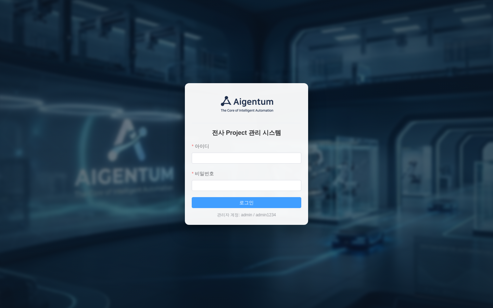

1. 브라우저에서 시스템 주소에 접속합니다.
2. **아이디**와 **비밀번호**를 입력하고 **로그인**을 누릅니다.
3. 로그인하면 **대시보드** 화면으로 이동합니다.

- 계정은 관리자가 **Admin 콘솔 > 사용자**에서 만들어 줍니다. (회원 가입 기능은 없습니다.)
- 로그인 상태는 8시간 동안 유지되고, 그 뒤에는 다시 로그인해야 합니다.
- 로그아웃은 화면 오른쪽 위의 **로그아웃** 버튼을 누릅니다.

### 1.3 화면 구성

| 위치 | 내용 |
|---|---|
| 맨 위 헤더 | 시스템 이름, 로그인한 사람 이름과 아이디, ADMIN 표시, 로그아웃 버튼 |
| 왼쪽 메뉴 | 대시보드, 이슈 관리, WBS, Admin 콘솔 |
| 왼쪽 아래 | **스킨** 선택 (낮 / 밤) |
| 가운데 | 선택한 메뉴의 화면 |

### 1.4 스킨(낮/밤) 바꾸기

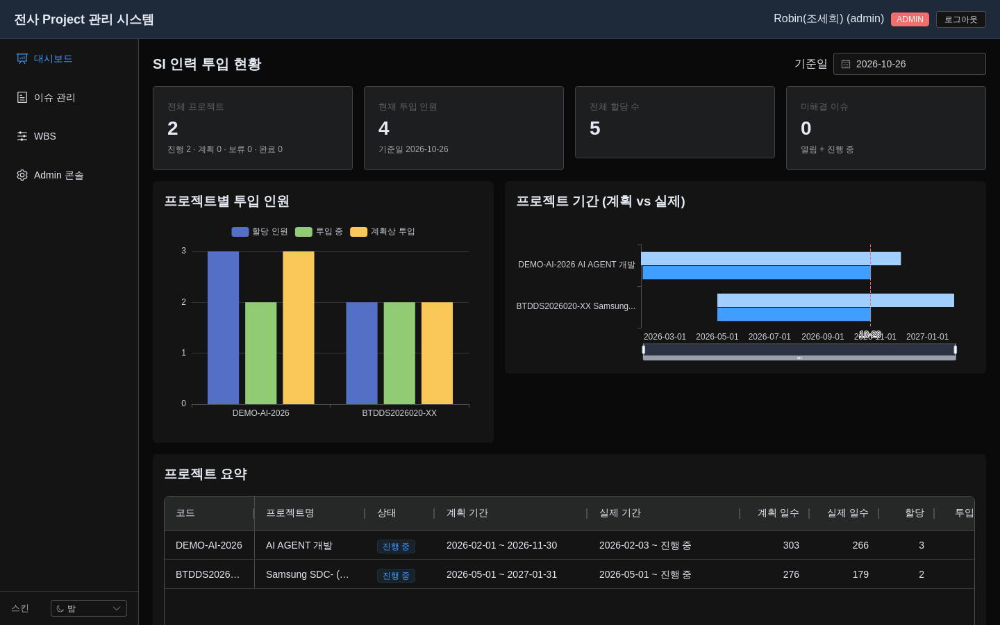

1. 왼쪽 아래 **스킨** 상자를 누릅니다.
2. **☀ 낮** 또는 **🌙 밤**을 고릅니다.
3. 화면이 바로 바뀌고, 선택한 스킨은 내 계정에 저장되어 다음에 로그인할 때도 유지됩니다.

---

## 2. 대시보드

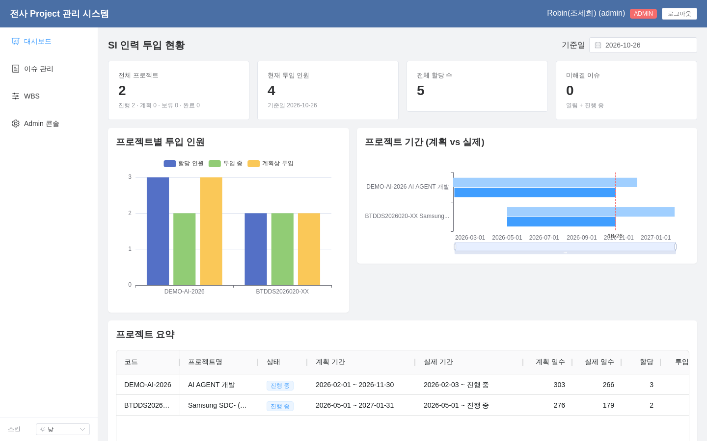

전체 프로젝트와 인력 투입 현황을 한눈에 봅니다. 오른쪽 위 **기준일**을 바꾸면 그 날짜 기준으로 다시 계산합니다.

| 영역 | 내용 |
|---|---|
| 요약 카드 | **전체 프로젝트**(상태별 개수), **현재 투입 인원**, **전체 할당 수**, **미해결 이슈**(열림 + 진행 중) |
| 프로젝트별 투입 인원 | 프로젝트마다 할당 인원 / 투입 중 / 계획상 투입 인원을 막대로 비교 |
| 프로젝트 기간 (계획 vs 실제) | 위쪽 연한 막대는 계획 기간, 아래쪽 진한 막대는 실제 기간. 빨간 점선은 기준일 |
| 프로젝트 요약 | 프로젝트별 코드, 상태, 계획·실제 기간, 일수, 인원 등 |

---

## 3. 이슈 관리

### 3.1 이슈 목록과 검색

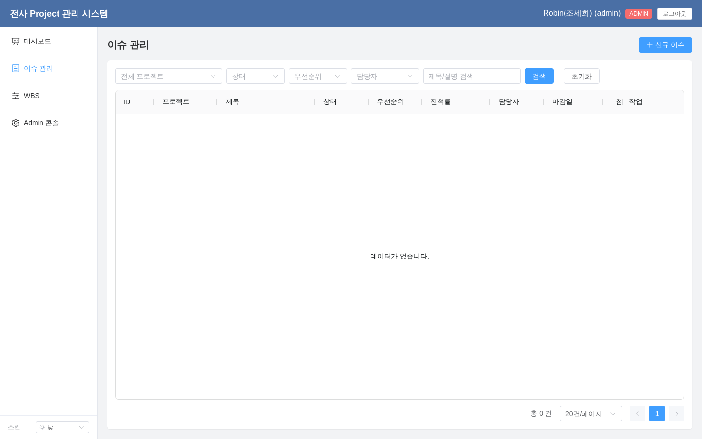

1. 왼쪽 메뉴에서 **이슈 관리**를 누릅니다.
2. 위쪽 검색 조건(**프로젝트, 상태, 우선순위, 담당자, 제목/설명 검색**)을 고르고 **검색**을 누릅니다. **초기화**를 누르면 조건이 지워집니다.
3. 표의 컬럼 제목을 누르면 정렬되고, 아래쪽에서 페이지와 한 페이지 건수를 바꿀 수 있습니다.
4. 이슈 행을 누르면 오른쪽에 **상세 화면**이 열립니다. 상세 화면에서 설명과 첨부파일을 보고, 수정·삭제할 수 있습니다.

### 3.2 이슈 등록

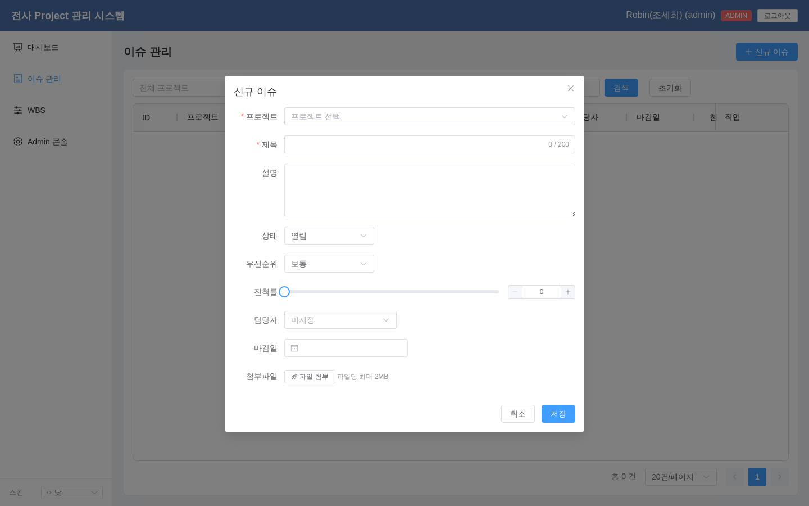

1. 오른쪽 위 **+ 신규 이슈**를 누릅니다.
2. 항목을 입력합니다. **\***가 붙은 항목은 꼭 입력해야 합니다.

| 항목 | 설명 |
|---|---|
| 프로젝트 \* | 이슈가 속한 프로젝트 |
| 제목 \* | 최대 200자 |
| 설명 | 자세한 내용 |
| 상태 | 열림 / 진행 중 / 해결 / 종료 |
| 우선순위 | 낮음 / 보통 / 높음 / 긴급 |
| 진척률 | 0~100% (막대를 끌거나 숫자 입력) |
| 담당자 | 처리할 사람 (비워 둘 수 있음) |
| 마감일 | 처리 기한 |
| 첨부파일 | **파일 첨부**로 추가. 파일당 최대 2MB |

3. **저장**을 누르면 목록 맨 위에 새 이슈가 나타납니다.

> **첨부파일 규칙**: 파일당 **2MB까지**, 허용 형식은 pdf, png, jpg, jpeg, gif, txt, log, csv, md, zip, doc, docx, xls, xlsx, ppt, pptx, hwp입니다. 규칙에 맞지 않으면 업로드 전에 안내가 나옵니다.

### 3.3 이슈 수정·삭제

- **수정**: 목록의 **수정** 버튼이나 상세 화면의 수정 버튼을 누르고, 내용을 고친 뒤 **저장**합니다.
- **삭제**: **삭제** 버튼을 누르고 확인합니다. 첨부파일도 함께 삭제됩니다. 이슈를 **등록한 본인** 또는 **관리자**만 삭제할 수 있습니다.

---

## 4. WBS (작업 분해 구조)

WBS는 프로젝트 일을 단계별로 나눠 일정과 진척률을 관리하는 화면입니다. **조회는 모두 가능**하고, **작성·수정은 그 프로젝트의 PM과 관리자만** 할 수 있습니다. 권한이 없으면 툴바 옆에 "조회 전용" 안내가 나옵니다.

### 4.1 WBS 보기 (Grid)

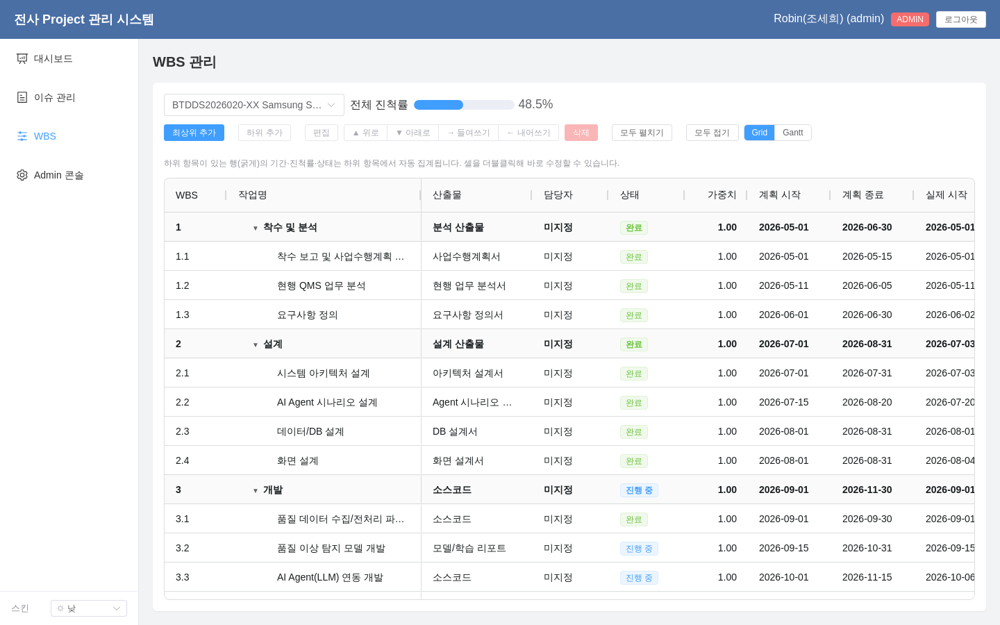

1. 왼쪽 메뉴에서 **WBS**를 누르고, 위쪽 상자에서 **프로젝트**를 고릅니다. (Admin 콘솔 > 프로젝트 목록의 **WBS** 버튼으로도 들어올 수 있습니다.)
2. 표에 WBS 번호(1, 1.1, 1.2 …), 작업명, 산출물, 담당자, 상태, 가중치, 계획·실제 일정, 진척률이 나옵니다.
3. 위쪽 **전체 진척률**은 프로젝트 전체의 가중 평균 진척률입니다.
4. 상위 항목 앞의 ▾ 표시를 누르면 접히고 펼쳐집니다. **모두 펼치기 / 모두 접기**도 쓸 수 있습니다.

> **굵은 글씨 행**(하위 항목이 있는 상위 항목)의 기간·진척률·상태는 하위 항목에서 **자동으로 계산**되므로 직접 입력하지 않습니다.

### 4.2 WBS 간트 차트 (Gantt)

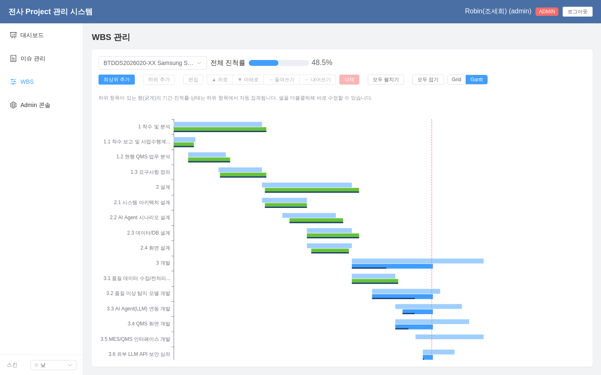

툴바 오른쪽의 **Grid / Gantt** 중 **Gantt**를 누르면 간트 차트로 바뀝니다.

| 표시 | 뜻 |
|---|---|
| 위쪽 연한 막대 | 계획 기간 (지연된 항목은 연한 빨강) |
| 아래쪽 진한 막대 | 실제 기간 (완료는 초록, 지연은 빨강, 진행 중은 파랑) |
| 막대 아래 얇은 선 | 진척률 |
| 빨간 점선 | 기준일(오늘) |

### 4.3 WBS 작성과 수정 (PM·관리자)

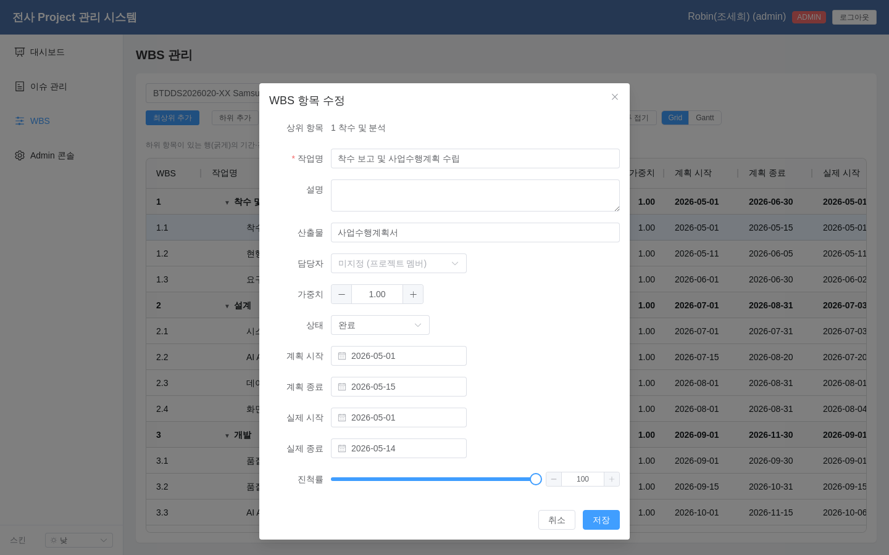

| 버튼 | 하는 일 |
|---|---|
| **최상위 추가** | 1단계 항목 추가 (예: 분석, 설계, 개발) |
| **하위 추가** | 선택한 행 아래에 하위 항목 추가 (최대 5단계) |
| **편집** | 선택한 항목을 팝업으로 수정 |
| **▲ 위로 / ▼ 아래로** | 같은 단계 안에서 순서 이동 |
| **→ 들여쓰기 / ← 내어쓰기** | 한 단계 아래로 / 위로 이동 |
| **삭제** | 선택한 항목 삭제 (하위 항목도 함께 삭제) |

1. 표에서 행을 한 번 눌러 선택한 뒤 버튼을 누릅니다.
2. 팝업에서 작업명, 산출물, 담당자(프로젝트 멤버 중 선택), 가중치, 상태, 계획·실제 일정, 진척률을 입력하고 **저장**합니다.
3. 표의 칸을 **두 번 클릭**하면 팝업 없이 바로 고칠 수 있습니다.

> **지연 표시**: 계획 종료일이 지났는데 진척률이 100% 미만이면 빨간색으로 표시됩니다.

---

## 5. Admin 콘솔

Admin 콘솔은 **프로젝트, 사용자, 월별 타임시트, 계획 vs 실제** 4개 탭으로 되어 있습니다. 모든 사용자가 볼 수 있지만, **등록·수정·삭제는 관리자만** 할 수 있습니다.

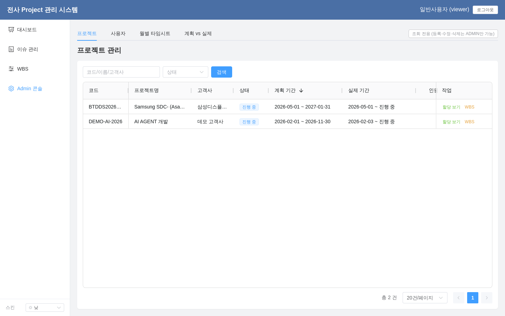

일반 사용자에게는 탭 오른쪽에 "**조회 전용 (등록·수정·삭제는 ADMIN만 가능)**" 안내가 표시되고, 등록·수정·삭제 버튼이 보이지 않습니다.

### 5.1 프로젝트 관리

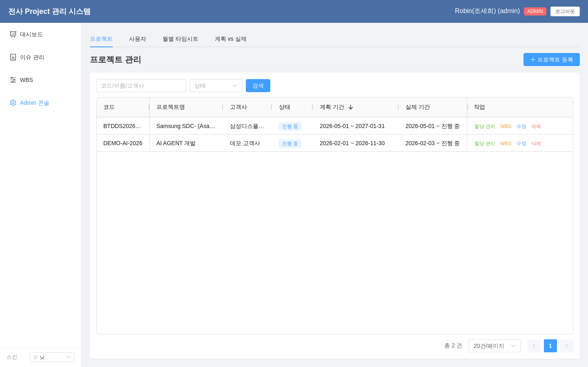

- 위쪽에서 **코드/이름/고객사**나 **상태**로 검색합니다.
- 각 행의 **작업** 버튼으로 **할당 관리**(일반 사용자는 "할당 보기"), **WBS**, **수정**, **삭제**를 합니다.

**프로젝트 등록** (관리자)

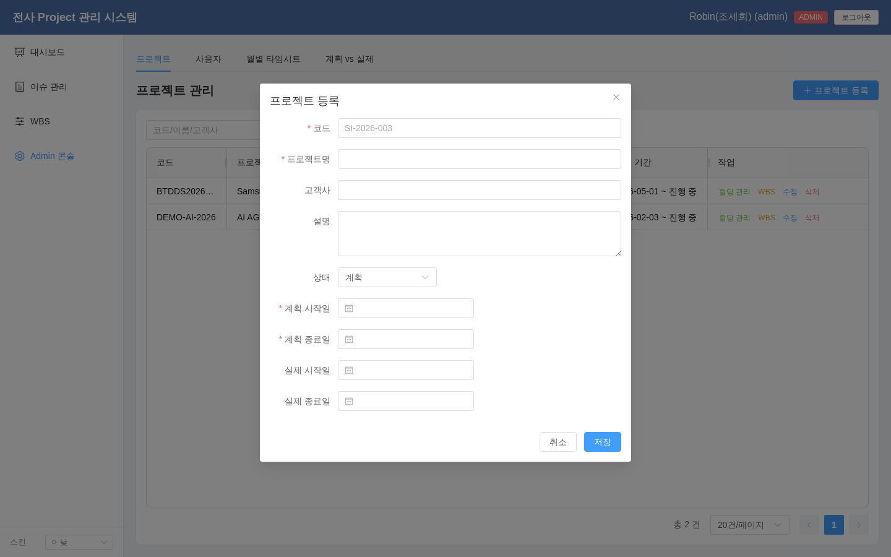

1. 오른쪽 위 **+ 프로젝트 등록**을 누릅니다.
2. **코드 \***(영문 대문자·숫자·-, 예: SI-2026-003), **프로젝트명 \***, 고객사, 설명, 상태, **계획 시작일 \***, **계획 종료일 \***, 실제 시작일·종료일을 입력하고 **저장**합니다.

- 프로젝트를 삭제하면 그 프로젝트의 인원 할당, 이슈(첨부파일 포함), WBS가 **모두 함께 삭제**됩니다.

### 5.2 인원 할당 (투입 관리)

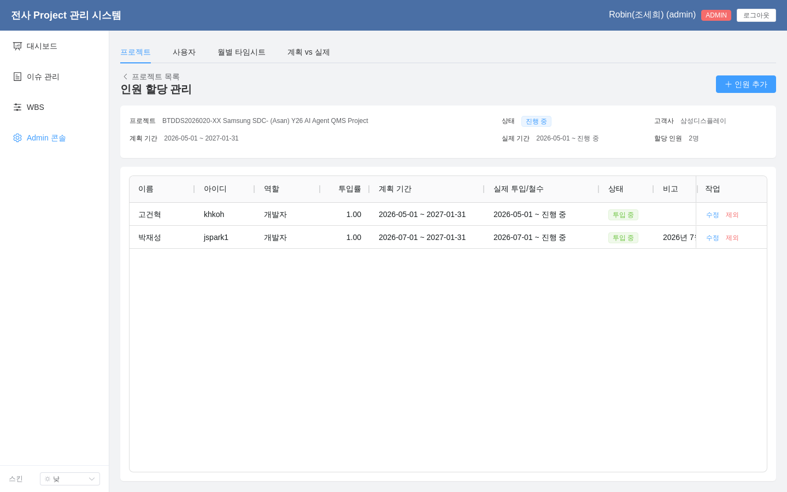

프로젝트 목록에서 **할당 관리**를 누르면 그 프로젝트에 투입된 인원 목록이 나옵니다. 위쪽에 프로젝트 정보(기간, 상태, 할당 인원)가 표시됩니다.

**인원 추가** (관리자)

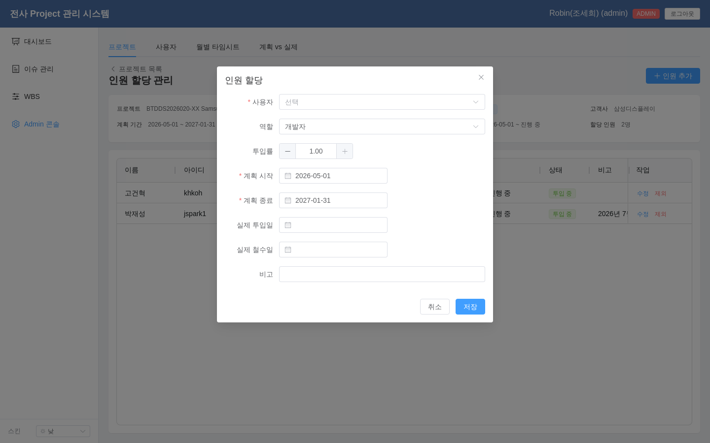

1. 오른쪽 위 **+ 인원 추가**를 누릅니다.
2. 항목을 입력하고 **저장**합니다.

| 항목 | 설명 |
|---|---|
| 사용자 \* | 투입할 사람 |
| 역할 | PM / 개발자 / 데이터 엔지니어 / 디자이너 / 퍼블리셔. **PM으로 지정하면 그 프로젝트의 WBS를 작성할 수 있습니다** |
| 투입률 | 0.01~1.00 (1.00 = 100% 투입) |
| 계획 시작 \* / 계획 종료 \* | 프로젝트 계획 기간 안이어야 합니다 |
| 실제 투입일 / 실제 철수일 | 실제로 들어오고 나간 날 |
| 비고 | 메모 |

- **같은 사람을 다시 할당**할 수 있지만, **계획 기간이 겹치면 안 됩니다.** (예: 1~3월 투입, 철수 후 6~8월 재투입은 가능) 이름이 같아도 아이디와 이메일이 다르면 다른 사람으로 봅니다.
- **제외** 버튼을 누르면 할당이 삭제됩니다.

### 5.3 사용자 관리

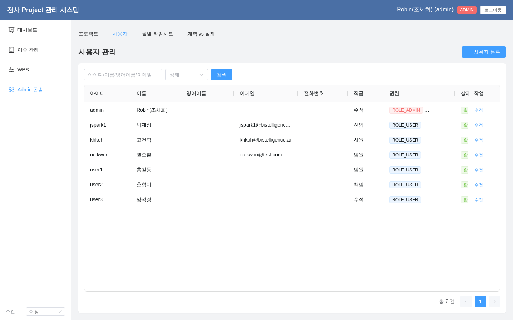

- 사용자 목록에 이름, 영어이름, 이메일, 전화번호, 직급, 권한, 상태(활성/비활성)가 나옵니다. **아이디**는 관리자에게만 보입니다.
- 위쪽에서 이름·영어 이름·이메일(관리자는 아이디 포함)과 상태로 검색합니다.

**사용자 등록·수정** (관리자)

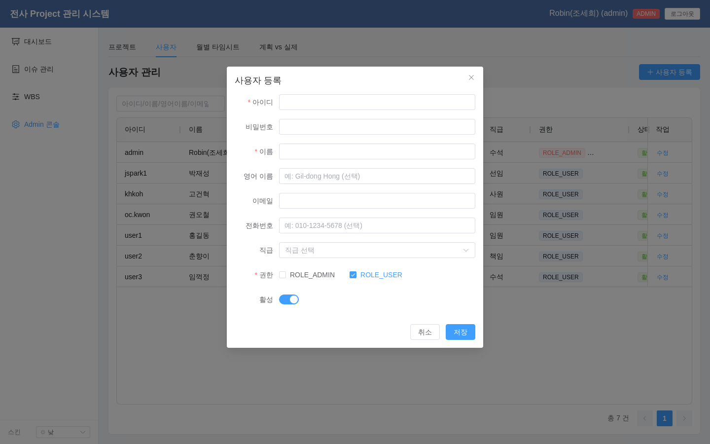

| 항목 | 설명 |
|---|---|
| 아이디 \* | 영문·숫자·`._-` 3~50자. 등록 후에는 바꿀 수 없음 |
| 비밀번호 | 등록 시 8~64자 필수. 수정 때는 비워 두면 바뀌지 않음 |
| 이름 \* | |
| 영어 이름 | 선택. 영문자로 시작, 영문자·공백·`. ' -`만 사용 (예: Gil-dong Hong) |
| 이메일 | 선택 |
| 전화번호 | 선택 (예: 010-1234-5678) |
| 직급 | 사원 / 선임 / 책임 / 수석 / 임원 / 대표 / 부대표 / 기타 |
| 권한 \* | ROLE_ADMIN(관리자), ROLE_USER(일반) 중 1개 이상 |
| 활성 | 끄면 그 사용자는 로그인할 수 없습니다 |

### 5.4 월별 타임시트 (MM)

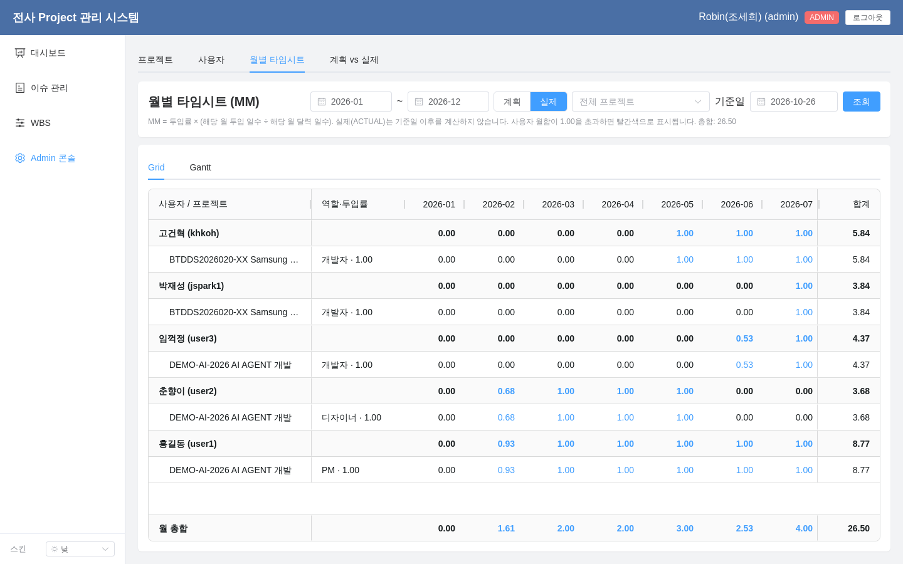

사람별·프로젝트별로 매월 몇 MM(인월)이 투입되었는지 봅니다.

1. **시작 월 ~ 종료 월**, **계획 / 실제** 기준, 프로젝트, **기준일**을 고르고 **조회**를 누릅니다.
2. 굵은 행은 사람별 합계, 그 아래 행은 프로젝트별 값입니다. 맨 아래 **월 총합** 행은 항상 보입니다.

| 표시 | 뜻 |
|---|---|
| 파란 숫자 | 0.00이 아닌 월 값 |
| 빨간 숫자 | 한 사람의 월합이 1.00을 넘음 (과다 할당) |

> **MM 계산**: MM = 투입률 × (해당 월 투입 일수 ÷ 해당 월 달력 일수). **실제** 기준은 기준일 이후를 계산하지 않습니다.

**Gantt 탭**을 누르면 사람·프로젝트별 투입 기간을 간트 차트로 봅니다.

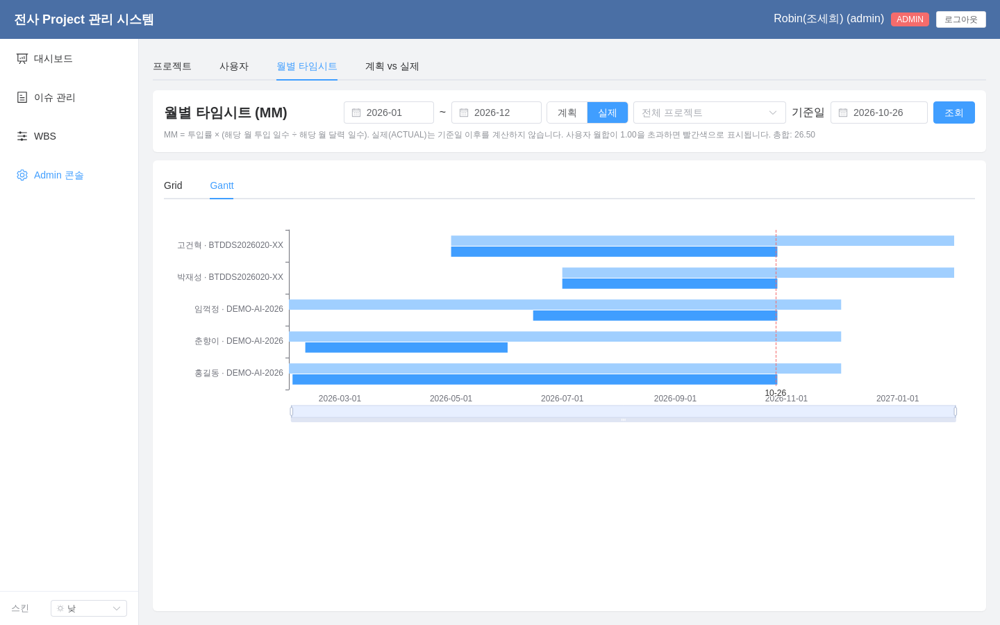

### 5.5 계획 vs 실제 투입 공기

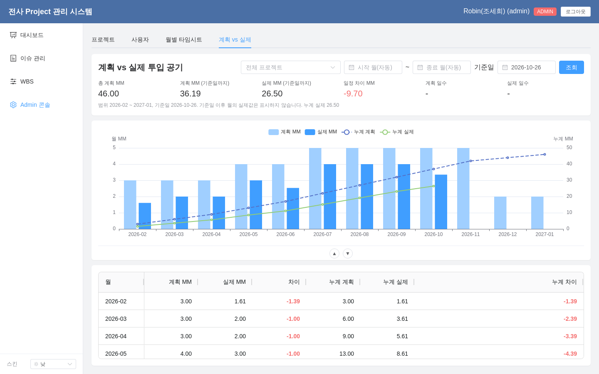

프로젝트의 **계획 MM과 실제 MM**을 월별로 비교합니다.

1. 위쪽 **조회 조건**에서 프로젝트, 기간(비워 두면 자동), 기준일을 고르고 **조회**를 누릅니다. 아래에 요약 수치(총 계획 MM, 기준일까지 계획·실제 MM, 일정 차이 MM, 계획·실제 일수)가 나옵니다.
2. 가운데 **차트**: 막대는 월별 계획·실제 MM, 선은 누계 계획·실제 MM입니다.
3. 아래 **표**: 월별 값과 차이가 나옵니다. 음수(실제 부족)는 빨간색입니다.
4. 차트 아래 가운데 **▲**를 누르면 차트를 접고 표를 크게, **▼**를 누르면 표를 접고 차트를 크게 봅니다. 반대 버튼을 누르면 원래대로 돌아옵니다.

---

## 6. 자주 나오는 안내 메시지

| 메시지 | 원인 | 해결 방법 |
|---|---|---|
| **다른 사람이 먼저 수정했습니다. 새로고침 후 다시 시도하세요.** | 화면을 연 뒤 다른 사람이 같은 항목을 먼저 저장하거나 지웠습니다 | 화면을 새로고침해서 바뀐 내용을 확인한 뒤 다시 저장·삭제합니다. 상대방의 변경은 지워지지 않습니다 |
| 같은 사람(…)이 이미 이 프로젝트에 … 기간으로 할당되어 있습니다 | 같은 사람을 겹치는 기간으로 다시 할당했습니다 | 계획 기간이 겹치지 않게 바꿉니다 |
| 파일 크기는 2MB를 초과할 수 없습니다 | 첨부파일이 2MB보다 큽니다 | 파일을 줄이거나 나눠서 올립니다 |
| 허용되지 않는 파일 형식입니다 | 허용되지 않은 확장자입니다 | 3.2의 허용 형식으로 바꿔 올립니다 |
| 조회 전용 (ADMIN 또는 이 프로젝트의 PM만 편집 가능) | WBS 편집 권한이 없습니다 | 관리자에게 그 프로젝트의 PM 할당을 요청합니다 |
| 로그인 화면으로 이동함 | 로그인 시간(8시간)이 지났거나 계정이 비활성화되었습니다 | 다시 로그인합니다. 안 되면 관리자에게 문의합니다 |
| 메뉴를 눌러도 화면이 안 바뀜 | 시스템이 새로 배포되기 전부터 열어 둔 화면입니다 | 보통 자동으로 새로고침됩니다. 안 되면 **Ctrl+F5**를 누릅니다 |

---

## 7. 처음 설정하는 순서 (관리자용 예시)

새 프로젝트를 시작할 때 관리자는 보통 다음 순서로 진행합니다.

1. **사용자 등록**: Admin 콘솔 > 사용자 > **사용자 등록**에서 참여자 계정을 만듭니다(직급 포함).
2. **프로젝트 등록**: Admin 콘솔 > 프로젝트 > **프로젝트 등록**에서 코드, 이름, 계획 기간을 입력합니다.
3. **인원 할당**: 프로젝트의 **할당 관리**에서 참여자를 추가하고 역할(PM, 개발자 등)과 기간을 정합니다. **PM을 반드시 1명 지정**합니다.
4. **WBS 작성**: PM이 로그인해서 **WBS** 메뉴에서 단계와 일정을 작성합니다.
5. **현황 확인**: 대시보드, Admin 콘솔의 **월별 타임시트**와 **계획 vs 실제**로 투입 현황을 확인합니다.
